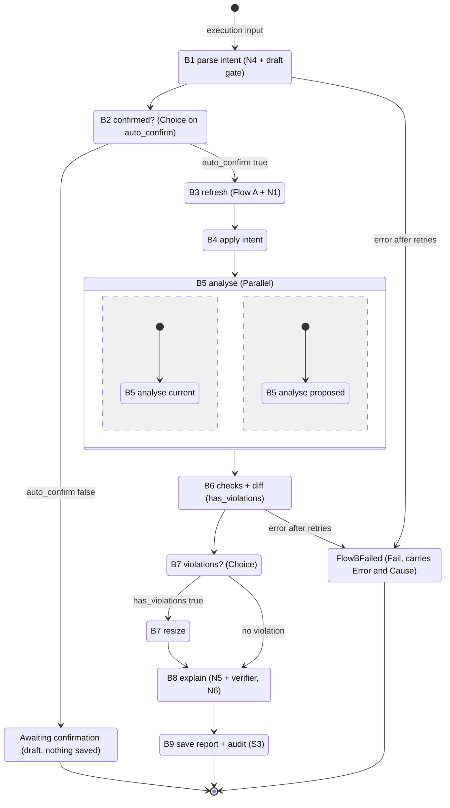

# CoherenceAnalyzer

Checks whether a self-directed investor's portfolio, or a trade they want to make, is coherent with their own profile. Deterministic rules own every limit. Bedrock LLM nodes fill narrow, gated slots. Datathon 2026 / PolyFinances AlphaForge AI.

- **Spec (source of truth):** [SPEC.md](SPEC.md)
- **Working rules:** [CLAUDE.md](CLAUDE.md)

## Setup

```
python -m venv .venv && . .venv/bin/activate
pip install -r requirements.txt
cp .env.example .env          # only needed for COHERENCE_ANALYZER_LLM=record (AWS creds + BEDROCK_MODEL_ID)
COHERENCE_ANALYZER_LLM=mock pytest -q
python -m coherence_analyzer.engine       # engine summary for the fixture portfolios
```

## Layout

```
data/starter/                alphaforge starter pack, unmodified (README.md + build_dataset.py from the organisers)
data/meta/                   hand-built, sourced meta files (see data/meta/SOURCES.md)
coherence_analyzer/          package (SPEC §2): engine, rules/, coherence/, factors/, llm/, gate, intent, resizer,
                             explain, stress, pipeline, store, api, cli, lambda_handler
coherence_analyzer/schemas/  profile.v2.json, report.json (JSON Schema)
fixtures/                    personas (robert, amira, mateo) + llm_cache/ for mock mode
docs/                        spec-decisions.md, spec-factors.md (approved SPEC resolutions), architecture.html
deploy/                      site/ (static dashboard), build_site.py, preview_report.py, whatif.py (site data),
                             cloudfront.yaml, aws/ (CloudFormation stack + Flow B state machine)
scripts/                     engine_v0.py (golden-test reference), handwrite_*_cache.py (mock cache), agent_loop.py
                             + strands_coder.py (build loop)
tests/                       pytest, all offline (COHERENCE_ANALYZER_LLM=mock); shared conftest.py at the top
  engine/                    engine golden test, goals, stress, ETF look-through
  profile/                   levels, derived rules, limits (+ no-LLM-inputs invariant), profile schema, intake
  checks/                    hard checks, meta checks, internal coherence, factors, lanes
  trade/                     intent.apply, resizer
  llm/                       Bedrock wrapper, gate, numcheck, explainer, question rubric, guardrail
  flows/                     Flow A/C pipeline, Flow B, personas end to end, API
  aws/                       S3 store, Step Functions (ASL + Lambda), template sync
  dashboard/                 static site, D10 site copy
  tooling/                   build-loop guard
.cache/                      git-ignored: live LLM cache, built site, local store output (see below)
```

The store writes `profiles/`, `portfolios/`, `reports/` and `audit/` under `COHERENCE_ANALYZER_STORE_DIR`, which
defaults to the current directory. To keep the repo root clean, run the demo with the store under `.cache/`:

```
COHERENCE_ANALYZER_STORE_DIR=.cache/store COHERENCE_ANALYZER_LLM=mock python -m coherence_analyzer.cli demo
```

Don't put `COHERENCE_ANALYZER_STORE_DIR` in `.env`: several tests `chdir` to a tmp dir and expect the store there.

## Status

The build order follows SPEC §17. Done:

- **P3.S4:** the dead `explain.build_payload` / `explain.template_explain` stubs are deleted (D5: section facts + `template_section`). S4 is unchanged: it reminds about unapproved parsed rules only (docs/spec-factors.md §20.2 preferences row and §20.8 Robert preferences `pass` win over the broader SPEC §7.4 wording, see Assumptions). `tests/checks/test_s4_noncheckable.py`.
- **P3.FLOWBG1:** the Flow B report (`pipeline.check`, the Lambda steps, the API confirm route) carries the G1 `goals` block and the P2.16 `stress` block, both on the proposed portfolio, info only (see Assumptions, "Contributions, goal_probs and G1"). G1 rows reach the objectif facts as in Flow C. `tests/flows/test_flow_b_goals_stress.py` passes; verdicts, headroom and metrics unchanged.
- **P3.SKIP:** a skipped intake answer (`{value: null, by: user:skipped}`, docs/spec-factors.md §20.6) no longer crashes the analysis. `rules/derive.derive_all` writes `{value: null, by: rule:...}` for every derived field with a skipped (or null) input; `rules/limits.build_limits` returns `null` for each limit that needs it and adds `"<path> (skipped)"` to that limit's `limits_trace`; `coherence/hard.py` reports `unknown` (message key `limit_not_computable`, `limit: null`, the skipped path in `derived_from`) instead of comparing with a missing limit; H14 is `unknown` when the stated reaction is skipped; C1-C5 treat a skipped answer as absent; `schemas/profile.v2.json` accepts the skip marker at the required paths (`$defs/skipped`) and a null `risk.capacity` / `risk.effective`; `pipeline._horizon_months` and `_goals_block` read a skipped horizon / goals list (see Assumptions). The verdict does not change (D3). `tests/profile/test_skipped_fields.py`.
- **P2.APIFB:** API Flow B (`api.py`). `POST /profiles/{id}/events` with `type: order_intent` appends the event, runs B1 (N4 through the gate, mock cache) and returns `{event, intent}`: the draft (`status: draft`) holds only what the user stated, the rest null (D10). `POST /intents/{id}/confirm` (body: `ticker`, `target_weight_pct`, `funding`; unknown keys, `limits`, `limits_trace` and `llm:` fields are a 422) appends an `intent_confirmed` event, runs B3-B9 and returns the Flow B report (`GET /reports/{run_id}` and `GET /audit/{run_id}` serve it). `tests/flows/test_api_flow_b.py` passes (one oracle assert fixed: it now snapshots `audit/` right after the draft).
- **P2.CLI19:** `cli review` (`_print_review`) prints the fixed disclaimer last, taken from the report (`config.DISCLAIMER` in the profile's locale), as `check` and `demo` do. README gains "Known limitations" (SPEC §19). `tests/flows/test_cli_disclaimer.py`.
- **P2.D10B:** D10 "Describe, never prescribe" applied to the site copy (`tests/dashboard/test_d10_site.py`). `deploy/site/design.html`: the `Option` tag / `k-option` style, the "Ce qui tient dans vos limites" block and the "Jusqu'à 2,0 %" card are gone; flow B shows one factual headroom line in the SPEC §8 FR template (« Avec le financement indiqué (ZST.TO), la transaction franchit votre limite H9 au-delà de 1,5 %. »), the prorata funding radios and the "ajoutez-la à vos exclusions" hint are removed. `deploy/whatif.py`: docstring now presents scenarios as inputs the user picks (asset, size, funding), no ordering or selection by outcome; output schema unchanged. `index.html`, `preview_report.py`, `build_site.py` are not touched (P2.SITE / P2.D10C).
- **P2.UI:** Dashboard Flow B UI (`tests/dashboard/test_ui_flow_b.py`), `deploy/site/index.html` only plus the report plumbing. `apiBase()` reads `<meta name="coherence-api-base" content="">` (empty in the shipped static page; `window.COHERENCE_API_BASE` overrides it); `apiPost(path, body)` is the single POST. N3: with an API, Approve / Reject call `POST /profiles/{id}/parsed-rules/{i}/decision` (`{approved}`) through `decideRule()` and re-render; with none the buttons stay disabled with « Affichage seulement ». B2: `renderIntentForm(rep.intent)` is an editable form (ticker, target weight, funding kind + ticker / asset class / amount), filled only from the draft intent (no default funding, empty first choice, D10); submit calls `POST /intents/{id}/confirm` through `confirmIntent()` and the response replaces the report; without an API the submit button is disabled. `cone(rep)` overlays `metrics_current` (« Avant », dashed) and `metrics_proposed` (« Après ») when the report has both. The trade report is loaded by `loadFlowB()` from its own file `reports/robert-nvda.json` (written by `build_site.build_flow_b` from `deploy/preview_report.py`), not through `reports/index.json`, which stays the 4 flow C reviews; the picker adds a « transaction demandée » entry for it. `preview_report.py` only gained display fields on `profile_card` (`objective_primary`, `horizon_years`, `goals`, `notes`). `coherence_analyzer/api.py` is not touched (P2.APIFB).
- **P3.UIINTAKE:** Dashboard B2 draft + confirm, intake form, theme number (`tests/dashboard/test_ui_intake_confirm.py`); `deploy/site/index.html`, `deploy/build_site.py`. With an API, `requestDraft(text)` posts an `order_intent` event (`POST /profiles/{id}/events`, body `type`, `text`, `ts` only) and `intentCard` shows the returned `intent` as the form (`state.draft`); `confirmIntent` sends exactly `ticker`, `target_weight_pct`, `funding` (`api.ConfirmIn` forbids other keys, the old merged body was a 422), and a confirmed intent is shown with its submit button disabled (409 otherwise). `renderIntake` shows `intake.next_question` (from `GET /profiles/{id}/intake`, `loadIntake`) with an answer field and a skip button (`answerIntake` / `skipIntake` -> `/intake/answer`, `/intake/skip`), then reloads; the static demo lists the missing paths read-only from `site.intake` (written by `build_site.missing_by_factor`, also added to `reports/robert-nvda.json`; `reports/index.json` is unchanged). `decideRule` asks for the share of a `max_theme_weight` rule with no number and sends it as `max_pct`. `api.py` and `coherence_analyzer/` are not touched.
- **P2.D10C:** D10 on the dashboard code path (`tests/dashboard/test_d10_dashboard.py`). `deploy/site/index.html` reads `headroom` (null | object) and shows one factual line only when it is non-null (flow B), in the SPEC §8 FR template (« Avec le financement indiqué (ZST.TO), la transaction franchit votre limite H9 au-delà de X %. »; any other headroom result shows the report's own `line`). `deploy/preview_report.py` builds `headroom` for the user's funding only (no `alternatives`, no `option` segment, no ranking), emits the §8 EN sentence as the last `fact` segment citing `headroom`, and keeps a what-if grid for that funding only. `build_site.py` needed no change (its reports come from `pipeline.review`, already `headroom: null`).
- **P2.15:** Flow B as a Step Functions state machine, not deployed: `deploy/aws/flow_b.asl.json` (B1 Task, B2 Choice on `auto_confirm`, B3 and B4 Tasks, B5 Parallel current / proposed, B6 Task, B7 Choice on `has_violations`, B8 and B9 Tasks; Retry on the Lambda service errors, Catch to the `FlowBFailed` Fail state), `coherence_analyzer/lambda_handler.py` (one Lambda, `event.step` = the pipeline step function), and in the CloudFormation template a Lambda, its log group, two least-privilege roles, the state machine and the `StateMachineArn` output (existing resources unchanged). `pipeline.b5_analyse` is split into `b5_analyse_current` / `b5_analyse_proposed`. `tests/aws/test_stepfunctions.py` runs the ASL locally with a test-only interpreter and gets the same report as `pipeline.check`. See AWS deploy.
- **P2.D10A:** D10 core ("describe, never prescribe"). The resizer evaluates the user's own funding only and returns one result; the report key `alternatives` became `headroom` (null | object, Flow B and C, schema, audit, CLI) with a template line (FR/EN, SPEC §8); explanation segment kind `option` removed; H7 below-band info states value and bound only; V4 blocklist widened and matched accent-insensitively, templates reworded where needed; explainer prompt bumped to `explainer.v2.md`, hand-written mock entries re-keyed (`python scripts/handwrite_explainer_cache.py` then `python scripts/handwrite_flow_b_cache.py`; real recorded v1 entries are now cache misses and fall back to the template until a human re-records them). `tests/test_d10.py` passes; the other listed tests were updated by phase A.
- **P2.16:** `stress.py` (rate-scenario stress, `tests/engine/test_stress.py`): bond ETF price change ~ -duration x Δy for parallel shocks of -100 / +100 / +200 bp plus a historical scenario (each held series' largest 12-month rise on month-end values in `macro_rates.csv`, up to the reference date). `data.load_macro_series` added; `pipeline.review` attaches a `stress` block (report schema: `status` is `info`, `feeds_limits` is `false`; never a check, never in the verdict or the limits). Numbers to narrate are pre-formatted in `stress.facts` (numcheck). Equities, crypto and gold are not modelled and the block says so. Durations are ASSUMED (see Assumptions); `data/meta/asset_meta.csv` columns `effective_duration`, `duration_source_url`, `duration_as_of` would make them sourced (none exist yet).
- **P2.13:** ETF sector look-through: `data.etf_sector_shares`, `engine.sector_lookthrough` (+ `meta_dir` hook on `analyse`), H6 adds the ETF look-through part, H10 stops flagging `Broad market` when `lookthrough` is true, `lookthrough` in the report `metrics` schema; `tests/engine/test_lookthrough.py` passes. `data/meta/etf_sector_weights.csv` (XIU.TO, SPY, QQQ, ESGV) is a human task and not built, so real runs are unchanged (`lookthrough: false`).
- **P2.FB:** Flow B trade check wired end to end offline (`pipeline.check` = `b1_parse_intent` ... `b9_save`, each step a dict-in / dict-out function with JSON-only content, ready to be wrapped as Step Functions states; `cli check <fixture> --intent in_0001 [--auto-confirm]`). N4 draft + draft gate, B2 stop without `--auto-confirm`, B3 Flow A with N1 through `gate.py`, `intent.apply`, engine on both sides (same seed), hard + soft checks (new S1 and S3 in `soft.py`, never `violation`), `report.diff` (flipped checks, deltas, top-3 drivers), resizer options as `alternatives`, five sections on the proposed checks, audit with model id / as_of / every gate decision. Hand-written N5 entries for the three non-pass Flow B sections: `python scripts/handwrite_flow_b_cache.py`. `tests/flows/test_flow_b.py` passes. The P0 stub pin in the offline pipeline tests was inverted to pin the wired check (oracle fix, standing approval).
- **P1.2:** `data.load_meta` validates the three meta files (§3.2: columns, sourced `activity_tags` rows, `mer_source_url` for any ETF fee, `themes` parsed to a list) and `coherence/hard.py` gains H11 (excluded activities), H12 (fees), H13 (theme weight) in `run_cheap`, owned by `contraintes`. `tests/checks/test_meta_checks.py` passes. The real `data/meta/*.csv` do not exist yet, so on Robert H11 and H12 report `unknown` for every held equity / ETF; two older frozen tests in `tests/checks/test_factors.py` pin the P0 list of contraintes checks and now fail: see `.claude/loop/BLOCKED.md`.
- **P0.1:** `data.py`, the engine refactor, and the golden test.
- **P0.2:** `levels.py`, `rules/registry.py`, `rules/derive.py`, `rules/limits.py` + tests.
- **P0.3:** `coherence_analyzer/schemas/profile.v2.json` (JSON Schema draft 2020-12) and the Robert fixture converted to schema v2 (`fixtures/robert/{profile.json, events.jsonl, intents.json}`).

- **P0.5:** `intent.py` (`apply` for every `funding.kind`) and `resizer.py` (SPEC §8 as written, docs/spec-decisions.md D2) + `tests/trade/test_intent.py`, `tests/trade/test_resizer.py`. Measured on the starter data: Robert + NVDA from ZST.TO tops out at 1.5% (H9 binds; SPEC §8's 5.0% / H4 is only the cheap-scan stop), pro_rata_all 2.0%, pro-rata etf_equity 2.0%, pro-rata equity 1.5%, all binding H9.
- **P0.6:** `llm/bedrock.py` (Converse wrapper, mock / record / live, lazy boto3), N1 `behaviour_classifier` + N4 `intent_parser` (schemas, `*.v1.md` prompts, extractors), `gate.py` (N1 and N3 paths, SPEC §11), hand-written Robert N1 + N4 responses in `fixtures/llm_cache/` (regenerate with `python scripts/handwrite_llm_cache.py`) + `tests/llm/test_gate.py`, `tests/llm/test_bedrock_mock.py`.
- **P0.10:** `intake.py` (`REQUIRED` per factor, pure `missing` / `next_question`, `skip`, `answer`; fixed fr-CA / en-CA questions, no LLM), N3 `values_parser` (schema, `values_parser.v1.md`, extractor, hand-written Robert and Amira cache entries via `scripts/handwrite_llm_cache.py`), approval of parsed rules into `limits` + `tests/profile/test_intake.py`.
- **P0.12:** parallel factor lanes (`explain.explain` on a 5-worker thread pool, same output as sequential) and the `profile_coherence` block of the Flow C report (`pipeline.review` -> `report.json` required block, audit entry for the N6 call with its gate status, `profile: ...` line in `cli review` / `demo`). `tests/checks/test_lanes.py` passes; see `.claude/loop/BLOCKED.md` for older tests that contradict it.
- **P0.11:** `coherence/internal.py` (internal coherence, docs/spec-factors.md §20.9 / D8): contradiction rules C1-C5 (`rule_findings`), the N6 `profile_consistency` payload / schema / prompt (`profile_consistency.v1.md`) / gate branch in `gate.py`, `check_profile` (rules, then N6, then the "rules win" dedupe; fixed fr-CA / en-CA questions) and a hand-written Robert N6 entry (`scripts/handwrite_llm_cache.py`) + `tests/checks/test_internal.py`. Not wired into the pipeline / report yet (`profile_coherence` block is a later task). Measured on Robert (as_of 2026-11-12): one C1 (goal "Help children with a down payment", 2032-01 vs a horizon ending 2030-11), C2-C5 silent, plus the hand-written N6 tension (`preferences.interests` vs `values.notes`) as `info`; status `warning`.

Everything else is stubbed with signatures and `NotImplementedError`. The matching tests are skip-marked with their build step.

- **P2.14:** `engine.analyse(monthly_contribution=, goals=, as_of=)` (contribution added to the NAV at the end of each simulated month, `goal_probs` per goal inside the horizon), `hard.g1` (G1, always `info`, assumption labels, no limit), `SectionContext.goal_checks` + `objectif` facts `goals` / `goal_assumptions`, the report's optional `goals` block (`schemas/report.json`) and `pipeline.review` wiring (a second simulation with Robert's declared `situation.monthly_contribution` and `objectives.goals`). `tests/engine/test_goals.py` passes; defaults keep every engine output bit-for-bit (golden test unchanged).

- **P0.7:** `factors/` (check -> factor mapping `CHECK_FACTOR` / `factor_of` / `tag_checks`, the five factor views, `SectionContext`, `build_sections`), `coherence/report.py` (`verdict_from_statuses`, `sections_verdict`, `build_sections`, `tag_checks`), `explain.numcheck` (engine in `numfacts.py`) and `explain.template_section` + `tests/checks/test_factors.py`, `tests/llm/test_numcheck.py`. Measured sections on Robert + NVDA 10% (D2): horizon `violation` (H9), risque `violation` (H4, H7, H8), contraintes `violation` (H3, H10), objectif and preferences `pass`; Robert baseline: contraintes `unknown` (H6, H10), the rest `pass`, verdict `coherent`. No LLM yet: `verify_section` and the narration loop are P0.8.
- **P0.8:** narration loop (docs/spec-factors.md §20.5): N5 `explainer` (`schemas/explainer.json`, `prompts/explainer.v1.md`, `extractors.explainer_call`), `explain.verify_section` (V1-V5), `explain.narrate_section` (`llm` -> `llm_retry` -> `template`, at most 2 calls per section, none for `pass` sections) and `explain.explain` (headline, disclaimer and pass sections are template text). Hand-written Robert + NVDA entries in `fixtures/llm_cache/` (`python scripts/handwrite_explainer_cache.py`): horizon `llm`, risque `llm_retry`, contraintes `template`. `tests/llm/test_explain.py` uses its own temporary cache.

- **P3.FLOWA:** `POST /profiles/{id}/events` runs Flow A (`pipeline.refresh`) for `question`, `quiz_result`, `profile_edit` and `note` events on the working copy and returns `{event, run_id, profile_diff, profile_version}` (the audit is at `/audit/{run_id}`). `quiz_result.payload.score` (0-1) sets `knowledge.quiz_score`; a `profile_edit` `{path, old, new}` applies `new` at `path` for declared fields only; an edit of `values.notes` reaches N3 through the gate (mock cache). Everything is validated before the event is appended; a failure after the append restores `events.jsonl` and `profile.json`. `pipeline.refresh(..., edited=)` / `_refresh(..., baseline=)` take the diff and the version against the stored profile so the edit itself is in `profile_diff`. `tests/flows/test_flow_a_events.py`.
- **P2.N2:** N2 `question_rubric` behind a flag (`config.N2_QUESTION_RUBRIC`, env `COHERENCE_ANALYZER_N2`, default off, D7): `question_rubric.v1.md` + schema, `extractors.n2_events` / `n2_payload` / `question_rubric_call`, `derive.question_score` / `question_quality_ewma` / `question_quality_confidence`, the N2 branch of `gate.gate`, two hand-written Robert entries (`scripts/handwrite_llm_cache.py`), and the Flow A hook (`pipeline._run_n2`: one call per question event, each gated into `knowledge.question_quality`, then derive). Off, Robert's `knowledge.score` stays 74; on, the recorded rubric gives 69.0 (the N2 term is clamped to -5 points) and no limit changes. `tests/llm/test_question_rubric.py`.
- **P0.9:** `pipeline.py` Flow A `refresh` (rules + N3 through the gate, only when `values.notes` changed; no N1/N2 unless the N2 flag is on) and Flow C `review` (engine -> hard checks + S2/S4 -> verdict -> five sections -> narration loop -> report + audit), `store.py` (local store, ULID run ids, report/audit/profile/portfolio files), `schemas/report.json` (§13 + sections), `coherence/soft.py` S2 and S4, `report.build_review`, `cli review [--portfolio FILE]`, `cli audit`, `cli demo`, `fixtures/robert/portfolio_review.json` (Robert after buying NVDA) + `tests/flows/test_pipeline_offline.py`. `cli review fixtures/robert --portfolio portfolio_review.json` -> `incoherent` (horizon, risque, contraintes `violation`); `cli review fixtures/robert` -> `coherent`, H6/H10 unknown. Flow B (`pipeline.check`) is not wired (P2). One more hand-written N5 entry covers Robert's current-portfolio `contraintes` section (`unknown`, mode `llm`).
- **P1.4:** `api.py` (FastAPI over the Flow C pipeline): `GET /health`, `GET /profiles`, `GET /profiles/{id}`, `GET /profiles/{id}/intake?locale=`, `POST /profiles/{id}/events`, `POST /profiles/{id}/intake/answer|skip`, `POST /profiles/{id}/parsed-rules/{index}/decision`, `POST /profiles/{id}/review`, `GET /reports/{run_id}`, `GET /audit/{run_id}`, CORS for GET/POST from any origin, and `tests/flows/test_api.py`. Fixtures are copied to `<store>/profiles/<profile_id>/` on first access and never written. `order_intent` events get 501 (Flow B is P2, D7).
- **P1.3:** S3 store backend (`COHERENCE_ANALYZER_STORE=s3`, same §10 keys, `store.py`), Bedrock Guardrail on the explainer call only (`llm/bedrock.py`, `GuardrailIntervened` ends the section in the template), CloudFormation template `deploy/aws/coherence-analyzer.cfn.json` (not deployed), README "AWS deploy", `.env.example`. `tests/aws/test_store_s3.py`, `tests/llm/test_guardrail.py` (botocore Stubber, offline).
- **P1.1:** Amira and Mateo fixtures complete (`fixtures/{amira,mateo}/profile.json` v2 with generated limits + trace, `events.jsonl`), hand-written N3 (Mateo) and N6 (Amira, Mateo) cache entries via `scripts/handwrite_llm_cache.py` + `tests/flows/test_personas.py`. `cli demo` now reviews three complete personas: Robert `coherent`, Amira `incoherent` (H2, H6, horizon section), Mateo `coherent` (H6, H10 unknown; profile check `pass`).
- **P2.SITE:** `deploy/build_site.py` (`build(out)`, default `.cache/site/`) now writes four real `pipeline.review` reports (Robert + NVDA, Robert current, Amira, Mateo) listed in `reports/index.json`, each with its own `site` extras (profile card, limits, weights). `deploy/site/index.html` renders the P2 blocks (`stress` table with the `sourced: false` assumption badge, G1 `goals`, the `metrics.lookthrough` note) and the SPEC §12 UI items that do not need Flow B: check rows with status chips whose click shows the `derived_from` chain, a fact / assumption / inference / unknown tag on every explanation segment (report-level and per factor), the unknowns list « Ce qu'on ne peut pas vérifier », display-only approve / reject buttons for parsed values rules, and the §19 limitations (« Limites connues », from `assumptions`). The before/after cone overlay and the intent confirmation form wait for Flow B (P2.FB). `tests/dashboard/test_site.py` passes (no browser, no network).
- **P3.GATE:** the gate enforces the N3 vocabulary and range (`gate.ACTIVITY_TAG_VOCABULARY`, the five tags SPEC §3.2 names; `gate.theme_vocabulary()`, the themes in `data/meta/asset_meta.csv`, read-only; `max_pct` in (0, 100] when present): a failing rule rejects the output (`rejected:schema`, previous value kept, nothing coerced). `extractors.n3_schema()` hands the same two enums to the model at runtime, like N4's ticker enum (the cache key does not include the schema, so the prompt stays `values_parser.v1` and no cache entry changes). `rules/limits.build_limits` skips an approved `max_theme_weight` rule without a theme and adds a `values.parsed_notes (skipped: ...)` entry to the `max_theme_weight` trace. The gate has an N4 branch (`intent_parser`): a draft whose action is not `buy` (or whose ticker, weight or funding fails the draft checks) is `rejected:schema`, so a sell is never confirmable. `tests/llm/test_gate_vocabulary.py`.
- **P3.O1:** check O1 (docs/spec-factors.md §20.2) is emitted by `hard.run_all`, so Flow B (both sides) and Flow C carry it: `objectives.primary = capital_preservation` and `engine.mdd` worse than the declared `risk.max_acceptable_drawdown_pct` gives `info` (never warning or violation, no verdict change), otherwise `pass`; a skipped or missing objective or accepted drawdown gives `unknown` (P3.SKIP, D3); another declared objective gives no row. `factors/objectif.NOT_COVERED` is now empty. `tests/checks/test_o1.py` (see `.claude/loop/BLOCKED.md` for one test line that reads a key the report schema does not have).
- **P3.RESIZE:** headroom counts only what the trade does. `resizer.violations_added(current, proposed)` keeps a proposed-side violation only if the current side did not have it, or had it and the trade made it worse; the resizer's grid index 0 is the current portfolio (no trade, nothing crossed), so a breach already present never makes `none_fit` true by itself and never appears in `binding_checks`. `pipeline.b7_resize` runs the resizer only when `violations_added` is non-empty. Robert + NVDA stays 1.5 % / H9 (D2). `tests/trade/test_headroom_preexisting.py`.
- **P3.FREETEXT:** `POST /profiles/{id}/intake/answer` and `/intake/skip` append one `profile_edit` event (`{path, old, new}`, source `intake`, server-assigned id and `ts`) to the working copy's `events.jsonl`, then run Flow A (`pipeline.refresh(edited=)`, as the events route does): limits are rebuilt from `rule:` fields and declared values, N3 runs through the gate only when `values.notes` changed. `values.notes` is now answerable (free text, non-blank string, not skippable); a gate rejection or a mock cache miss keeps the previous `parsed_notes` and the response's `intake` block (`event`, `run_id`, `profile_diff`, `llm_calls`, `llm_errors`, `messages`) says why. Structured answers call no LLM. A failure restores `events.jsonl` and `profile.json`. `intake.py`: `FREE_TEXT_PATHS`, `current_value`, `event_text`. `tests/flows/test_intake_events.py` passes except two tests whose `limits_trace` prefix check contradicts other frozen tests (see `.claude/loop/BLOCKED.md`).
- **P4.WARNEN:** the gate stamps `warn_enabled = confidence >= config.WARN_MIN_CONF` (SPEC §11 step 5) on an accepted or clamped N1, N2 and N3 `llm:` field; `schemas/profile.v2.json` accepts it as an optional boolean on `llmField`. Kept and rejected outputs return the previous field untouched (no new stamp, an old flag is not recomputed). `coherence/soft.py` keeps its own comparison, so no check changes. `tests/llm/test_gate_warn_enabled.py`.
Remaining TODOs:
- Robert's `llm:` fields are hand-written (`model_id: fixture:hand-written`) until the Bedrock cache is recorded (P1.11).
- First real Bedrock recording (P1.11, partial): `COHERENCE_ANALYZER_LLM=record BEDROCK_MODEL_ID=us.anthropic.claude-haiku-5-5 python -m coherence_analyzer.cli demo` recorded 11 N5 `explainer` and 3 N6 `profile_consistency` responses (Haiku 5.5, guardrail on) next to the hand-written entries (the cache key includes the model id). Replay offline with `COHERENCE_ANALYZER_LLM=mock BEDROCK_MODEL_ID=us.anthropic.claude-haiku-5-5 python -m coherence_analyzer.cli demo`; with the `.env` model id the tests keep reading the hand-written entries. Same verdicts as the hand-written run. Section modes: Robert + NVDA horizon `llm`, risque and contraintes `llm_retry`; Amira horizon and preferences `llm`, contraintes `llm_retry`; Mateo preferences `llm`; the `unknown` contraintes sections of Robert (current) and Mateo end in the template (first answer rejected by the verifier, second not accepted). Robert's N6 recording is not committed: the frozen N6 test of P0.11 expects a single cached N6 entry for his payload, so his N6 stays hand-written (2 N6 entries committed). N1, N3 and N4 were not called by `demo` (notes unchanged, no Flow B), so `llm:` profile fields are still hand-written.

## Run the API

```
pip install -r requirements.txt
COHERENCE_ANALYZER_LLM=mock uvicorn coherence_analyzer.api:app --reload   # docs at http://127.0.0.1:8000/docs
```

Working copies live under `COHERENCE_ANALYZER_STORE_DIR` (default: the current directory) in `profiles/<profile_id>/`; `fixtures/` is never written.

## Data

- **Prices:** listing currency (`.TO` is CAD, everything else USD). Converted to CAD with month-end USDCAD, forward-filled.
- **Calendars:** no calendar alignment. Monthly resampling (`ME`, last) absorbs TSX/US/crypto calendar differences.
- **Window:** monthly returns 2022-01 → 2026-10 (58 months). `iloc[2:-1]` also drops Dec 2021; this is kept for golden parity (SPEC §3.1). The window includes 2022, when stocks and bonds fell together.
- **Survivorship bias:** the universe was selected in 2026.

## Assumptions

- **S4 scope (P3.S4):** SPEC §7.4 says "unapproved or non-checkable" rules, but docs/spec-factors.md is more specific and wins (CLAUDE.md): §20.2 lists S4 for unapproved parsed rules only and §20.8 pins Robert (two approved prefer / avoid rules) at preferences `pass`. So an approved rule of any kind gets no S4 reminder; a theme rule with no number is asked for by the intake instead. Never in the verdict.
- **O1 (P3.O1, docs/spec-factors.md §20.2):** SPEC-AMBIGUITY resolved: (1) kind `hard` (rule-based, like H14), status never above `info`, source `rule:objective_vs_drawdown`. (2) The comparison is strict (`mdd < max_acceptable_drawdown_pct / 100`, 1e-9 tolerance): a drawdown exactly at the declared figure is `pass`. It uses the declared figure, not the derived `limits.max_drawdown_pct`; no `llm:` field is read. The declared figure is read as a negative percent, as in the fixtures. (3) A profile whose objective is another value gets no O1 row (the check does not apply) rather than a `pass` row. (4) O1 sits in `run_all` only, not in `run_engine`, so the resizer's headroom search is unchanged. (5) The message states the measured drawdown only (D10); the declared figure is in the facts.
- **Skipped intake answers (P3.SKIP, docs/spec-factors.md §20.6):** a derived field or limit whose input is skipped is `null`, never a default (strictest reading: `risk.capacity` and `risk.effective` are null as soon as one of their inputs is skipped, even when the missing notch could only lower the level). A skipped `planned_withdrawals` is unknown, while an empty list is the user's answer "none". `limits_trace` keeps the full input list of each limit and appends `"<path> (skipped)"` for each skipped input. When `objectives.horizon_years` is skipped the engine still needs a window to compute its descriptive metrics (H14 uses the historical drawdown): `pipeline.UNKNOWN_HORIZON_SIM_MONTHS = 60` is used for that simulation only; no limit or check that depends on the horizon uses it (they are `unknown`). A skipped `objectives.goals` means no goal simulation (G1 has nothing to report).

- **API Flow B (P2.APIFB), SPEC-AMBIGUITY resolutions.** (1) The order_intent response is `{event, intent}`; other event types keep returning the bare event. (2) D10 wins over SPEC §3.6 "default shown before they confirm": a field N4 lists in `ambiguous_fields` (a default or a guess, e.g. `funding: pro_rata_all`) is null in the draft; a draft that fails the gate or whose N4 call has no recorded answer returns 200 with every field null, never a guess. `unstated_fields` lists the null fields. (3) Drafts live in the working copy (`intents.json`, plus `intent_drafts.json` for the gate status and call log); intent ids are unique across all profiles (`in_NNNN`, highest + 1). (4) Confirm needs ticker, weight and a funding (kind + its one parameter) from the user: nothing is defaulted. It validates the trade with `intent.apply` before writing anything (422 on failure). (5) Confirming an already confirmed intent is a 409 (no second event, no second run). (6) `intent_confirmed` gets `ts` = confirmation time and `confirmed_at`: wall-clock audit metadata only, no computed value uses it.
- **`data/meta/asset_meta.csv` themes are a team assumption** (`tech_heavy` = QQQ + single tech names; broad index ETFs carry no theme). All nine ETF MERs are sourced from issuer pages or fact sheets (retrieved 2026-11-14; ZST.TO's latest published MER is as of 2025-06-30). Details: `data/meta/SOURCES.md`.

All persona financial figures beyond the case brief are fictional team assumptions.

- **Rate stress (P2.16), `sourced: false`:** the starter data has no duration column, so effective durations are an ASSUMED table in `stress.py` (years): XBB.TO 7.3, ZST.TO 0.3, AGG 6.0, TLT 16.5, approximate for the tracked indices; a human must replace them with issuer-published values (URL + date) in `asset_meta.csv`. Price change = -duration x Δy, first order, no convexity (no sourced convexity); parallel shifts only (-100 / +100 / +200 bp); USD bond ETFs are shocked in CAD value with USDCAD held constant. Each ETF's yield is proxied by a benchmark in `macro_rates.csv` (XBB.TO -> BD.CDN.10YR.DQ.YLD, ZST.TO -> BD.CDN.2YR.DQ.YLD, AGG and TLT -> DGS10), used for context and the historical scenario only. Equities, crypto and gold: no modelled impact (no rate beta estimated). Info only, not a forecast, never an input of limits or the verdict.

- **Engine drift (annual, CAD):** Stocks / Equity ETFs 6%, Bonds 3%, Gold 3%, Crypto 6%. A team assumption, not a forecast.
- **Bootstrap:** circular block, block = 12 months, n = 5000, seed = 7.
- **Limits table (SPEC §7.2):** team calibrations, not regulation. *TODO: justify each column.*
- **Knowledge score weights:** 0.4 quiz / 0.3 declared / 0.3 question quality, with `declared_map` calibrated so Robert = 74.
- **Mateo portfolio:** suggested in SPEC §3.5 (fictional).
- **Schema location:** `profile.v2.json` lives in `coherence_analyzer/schemas/` (`config.SCHEMAS_DIR`), which is what SPEC §3.3's `schemas/profile.v2.json` refers to.
- **Amira and Mateo fixtures (P1.1), all fictional team assumptions beyond the SPEC §16 brief** (reference date `portfolio.as_of` = 2026-11-12, D1):
  - *Amira* (`fixtures/amira/`): income band 90k-120k CAD; monthly expenses $3,200; emergency fund $16,000 (= 5.0 months, so capacity stays `high`); student loan $6,000 (no consumer debt); monthly contribution $900; horizon 20 years, retirement target age 65, no planned withdrawals; one goal "Financial independence fund", $500,000 in 2046-06 (inside the horizon, so C1 stays silent); max acceptable drawdown -35%; reaction to a 20% drop `buy_more`; quiz score 0.75 (knowledge.score 45.0 with no question-quality term, N2 is off); refuses options, leveraged ETFs and margin, crypto allowed; max MER 0.5%; interests `ai`, `new_tech`, `crypto`; 3 years investing. Rules give early_accumulation, income_stability `high`, capacity `high`, effective `high`; limits are the `high` row, floor 60,000 x 0.60 = $36,000.
  - Amira's N3 rule `max_theme_weight {theme: tech_heavy}` has no number in the notes (§20.6): the fixture stores her intake answer `max_pct: 50` with `approved_by_user: true` (so `limits.max_theme_weight = {tech_heavy: 0.50}`). Her other parsed rule (`prefer_attribute ai_and_new_tech`) stays unapproved.
  - *Mateo* (`fixtures/mateo/`): common-law partner, 2 children, Industrials employer; income band 120k-150k CAD (household); monthly expenses $5,200; emergency fund $31,200 (= 6.0 months); mortgage $260,000, real-estate equity $220,000, no pension; monthly contribution $1,200; horizon 10 years, retirement target age 65; planned withdrawal $40,000 in 2034-09 (children's post-secondary education, year 1), which is also his only goal (effective horizon 7.8 years, capacity `moderate`, effective `moderate`; no withdrawal inside 24 months); max acceptable drawdown -20%; reaction `hold`; quiz score 0.7 (knowledge.score 43.0); refuses crypto, options, leveraged ETFs and margin; max MER 0.5%; interests `esg_funds`, `dividend_income`; prefers dividends and large caps; 9 years investing. Limits are the `moderate` row, floor 150,000 x 0.85 = $127,500.
  - Mateo's two N3 `exclude_activity` rules are stored `approved_by_user: true` because he declared the same two tags in `values.environment` / `values.social`; the `other` ("open to new tech if it fits") and `avoid_attribute speculative` rules stay `false`.
  - Event logs: ids `ev_<persona>_0001..`, local Montreal offsets (-04:00 until DST ended on 2026-11-01, -05:00 after), all dated up to 2026-11-12; the quiz score of the last `quiz_result` is the profile's `quiz_score`. Amira: quiz + two long-term-framing questions + one crypto FOMO question. Mateo: quiz + two ESG / controversy questions.
  - Hand-written N3 and N6 cache entries (`model_id: fixture:hand-written`, `python scripts/handwrite_llm_cache.py`). N6 for Amira: one `tension` between `preferences.interests` (`new_tech`) and her note; for Mateo: no finding (does not abstain). Replaced by recordings in P1.11.
  - Cheap checks measured on the starter data (`meta={}`): Amira H2 violation (crypto 0.15 vs 0.10) and H6 violation (NVDA 0.08 + SHOP.TO 0.08 = 0.16 vs 0.15) plus an `unknown` for the ETF part, verdict `incoherent`. Mateo: H1-H5 pass; his verdict follows from the engine checks (unknowns only list under "cannot verify").
- **Robert v2 conversion (P0.3):**
  - The `llm:` field values (behavioural `moderate_high` @ 0.55, question quality 0.62 @ 0.6, parsed notes @ 0.8) are kept from the v1 example. They are hand-written stand-ins, stamped `model_id: fixture:hand-written`, `prompt_version: <node>.v1`, `updated_at: 2026-11-14T10:03:00-05:00`.
  - `input_hash` = `sha256:` of the node input as canonical JSON (sorted keys, `,`/`:` separators, UTF-8): behaviour = the question/order_intent events `[{event_id, ts, type, text}]` (all three, including ev_0007 dated after `portfolio.as_of`); question rubric = `[{event_id, text}]` for the question events; values parser = the `values.notes` string.
  - Question quality 0.62 is not the N2 EWMA of the two scores (that would give 0.48). It is kept because knowledge.score = 74 is calibrated on it; N2 recomputes it in P1.
  - The v1 free-text parsed rule `prefer_understandable_business` (approved) is split into two approved items, one per sentence of the notes: `prefer_attribute {attribute: understandable_business}` and `avoid_attribute {attribute: hype}`, both `applies_to: single_stocks`. Neither kind is promoted into `limits` (§6.2 N3), so limits are unchanged.
  - Event timestamps carry the Montreal local offset (-05:00; DST ended 2026-11-01 at 02:00, before the quiz event); intent `in_0001` is confirmed 3 minutes after ev_0007.
  - `limits_trace` is the output of `rules.limits.build_trace()`, written verbatim (a test checks it matches).

- **intent.apply (P0.5), cases SPEC §3.6 leaves open:**
  - Only `buy` with a target at or above the current weight is applied; anything else raises `ValueError`.
  - `specific`: a funding ticker holding less than the needed weight raises `ValueError` (never negative weights). Tickers that reach 0 are dropped from the result.
  - `pro_rata_class`: the pool is every held ticker of that `asset_class` (from `assets_universe`) *except the target*, which never funds itself. An empty or too-small pool raises `ValueError`.
  - `cash_contribution`: new value = value + amount; nothing is sold, so existing holdings keep their CAD value. The ticker gets the cash up to its target (of the enlarged portfolio). An under-funded purchase leaves the ticker below target. Cash beyond the target is spread pro rata over the other holdings, so weights always sum to 100.
- **Resizer (P0.5):**
  - The portfolio dict passed in carries `horizon_months` (SPEC §3.5 fixture value, 48 for Robert), since §8 gives the resizer no horizon argument.
  - "Binary search downward" runs on the 0.5 pp grid of the cheap scan (`config.RESIZER_STEP_PP`), so results are grid values. After the n=1000 search, the n=5000 confirmation steps down while H7-H10 fail and up while the next grid point still passes. A held target ticker starts the grid at its current weight.
  - The resizer is a headroom measurement of the user's own trade (D10, SPEC §8): it evaluates the funding stated in the intent and no other (no `pro_rata_*` candidate of its own; those modes stay valid when the user states them), and returns ONE result `{funding, max_weight_pct, binding_check, metrics}` or `{none_fit: true, binding_checks}`. `binding_check` is the first violated check at the next grid point (`None` when the whole target fits, `FUNDING` when the source cannot cover it).
  - Golden values are in `tests/trade/test_resizer.py` (D2 replaces the "5.0% H4 / 8.0% H3" expectation).
- **LLM wrapper, N1, N4, gate (P0.6):**
  - Cache files: one per call, `<node>.<cache_key>.json` (the key is `cache_key()`), holding payload, output and call log. `mock` and `record` use `fixtures/llm_cache/`, `live` uses `.cache/llm/`; `mock` never falls back to the live cache. `record` reuses a fixtures hit instead of calling Bedrock again.
  - Mock model id: the key uses `BEDROCK_MODEL_ID`, then falls back to `fixture:hand-written`, the model id stamped on the hand-written entries, so the offline suite passes whatever the local `.env` says. `record` / `live` require `BEDROCK_MODEL_ID`.
  - The hand-written N1 response for Robert is `moderate_high` @ 0.55 citing ev_robert_0007 and ev_robert_0004 as `hype_chasing` (same as the profile fixture). The hand-written N4 draft is NVDA 10% with the default funding `pro_rata_all`, and `funding` listed in `ambiguous_fields`, since the sentence names no source.
  - Retry on a schema failure: the model's tool call is replayed, then a user turn carrying a `toolResult` with `status: error` and the validator message.
  - N1 input is `{"events": [{event_id, ts, type, text}]}`, oldest first, newest 20. With `as_of` (D1) it drops events older than 30 days before it and has no upper bound, so ev_robert_0007 (dated after `portfolio.as_of`) is included. Without `as_of` there is no window filter.
  - N1 schema: `abstain` and `evidence` are always required; `value` and `confidence` (0 to 0.8) are required when `abstain` is false, with at least one evidence item. The gate also treats an empty evidence list on a non-abstaining output as `rejected:evidence`.
  - N4 schema is one flat object (the §3.6 fields minus `intent_id`, `event_id`, `status`, which the LLM does not produce) plus `ambiguous_fields` and `unresolved_mentions`. `ticker` (and `funding.specific.ticker`) get an enum generated from the universe at runtime. A mention that maps to no ticker cannot be expressed as a valid draft yet: the call fails validation. Handling that case is a P1 pipeline task.
  - Gate: confidence outside 0 to `BEHAVIOUR_MAX_CONF` (0.8) is `rejected:schema`. A value that is not in the level enum, or an unknown signal, is `rejected:schema`. A first behavioural value (no previous one) is not clamped. N3: a rule identical to one the user already approved keeps `approved_by_user: true`, every other rule starts `false`. N3 has no confidence in its output, so the previous confidence is kept, with 0.8 as the fallback. Gates for N2 are described under P2.N2 below; the gate returns `rejected:schema` for nodes it does not know.
- **N2 question_rubric (P2.N2):**
  - Opt-in flag `COHERENCE_ANALYZER_N2` (default off, D7 point 3). Off: Flow A calls no N2 and Robert's `knowledge.score` stays 74 from the stored `question_quality`. On: N2 runs on every question event (oldest first), each output goes through the gate.
  - Code computes `score = sum of the four 0-3 sub-scores / 12` (4 decimals). `question_quality.value` = EWMA (alpha 0.3, `config.QUESTION_EWMA_ALPHA`) over the stored per-question scores, oldest first by event `ts`; re-scoring a question replaces its evidence item. Evidence items are exactly `{event_id, score}`; the quote is checked against the event text and not stored.
  - Confidence is computed by code, never by the model: `min(0.8, 0.3 + 0.15 x scored questions)` (`QUESTION_QUALITY_MAX_CONF` 0.8, same cap as N1). Robert's two questions give 0.6, as in his fixture.
  - Gate: the output must cite the input event (`event_id` equal to the call's event, an existing `question` event) and a non-empty `quote` that is an exact substring of its text (else `rejected:evidence`); a sub-score outside 0-3 or not an integer, a non-boolean `is_investing_question`, a rationale over 150 characters, or an extra key such as `score` / `confidence` is `rejected:schema`; `is_investing_question: false` is ignored (`kept:abstain`, previous value kept).
  - A failed N2 call (cache miss in mock mode) is recorded in `audit.llm_errors` and the previous value stays; other questions still apply.
  - `knowledge.score` keeps its SPEC §7.1 formula; the N2 term moves at most 5 points from the previous run's term. Measured on Robert with the recorded rubric (AI question 1/12, XBB question 10/12): EWMA 0.31, term 9.3 versus previous 18.6, clamped to 13.6, so the score is 69.0 (history gets one more point). `knowledge.question_quality` is not a limits input (invariant 2) and S2 still only returns `warning` / `info` / `unknown`.
  - `rules/limits.build_limits` now emits the fixed `_note` ("Derived from the profile only...") that the fixtures already carry, so a refreshed profile's `limits` equals the stored one. It is a description, not a limit.
  - `coherence/soft.py` checks are now a dict subclass that also reads as attributes (`c.status`); still plain dicts for JSON and indexing.
- **Intake and N3 (P0.10):**
  - `intake.REQUIRED` paths (team choice, §20.6 fixes none): objectif `objectives.primary, objectives.goals`; horizon `objectives.horizon_years, identity.retirement_target_age, situation.planned_withdrawals`; risque `risk.declared, risk.max_acceptable_drawdown_pct, risk.reaction_to_20pct_drop`; contraintes `situation.emergency_fund, situation.monthly_expenses, identity.employer_sector, preferences.asset_types_refused`; preferences `preferences.prefers_dividends, prefers_large_caps, home_bias_ok`. Only user-declared fields: never `rule:` or `llm:` fields.
  - A path is missing when absent, `null`, or a blank string. `0`, `false`, `[]` are real answers. Only `{value: null, by: "user:skipped"}` counts as answered-by-skip.
  - A question is `{factor, path, text, locale}`. A parsed `max_theme_weight` rule with no numeric `max_pct` adds the path `values.parsed_notes.value[<i>].params.max_pct` to `contraintes.missing` (approved or not); the question quotes the user's words and names the theme.
  - `build_limits` promotes an approved `max_theme_weight` only when `max_pct` is a number, and an approved `exclude_activity` only when `tag` is a string. An approved rule whose number is still unanswered or skipped changes nothing.
  - N3 payload is `{"notes": <values.notes>}` (the cache key). The `input_hash` stamped in Robert's fixture (hash of the bare notes string) therefore differs from a fresh run's. Hand-written N3 cache entries cover Robert's notes (two soft rules) and Amira's notes (`prefer_attribute` + `max_theme_weight {theme: tech_heavy}` with no number); the tag vocabulary `data/meta/activity_tags.csv` is human-owned and was not touched.
- **Factors, sections, numcheck, template (P0.7):**
  - Section `checks` lists the id of every check of the factor present in the reported checks (pass ones included, once each, in run order); `facts.checks` and `unknowns` hold the non-pass entries only. Status = worst owned check (`violation > warning > unknown > info > pass`) on `checks_proposed` in flow B, `checks_current` in flow C. A section whose only non-pass checks are `unknown` is `unknown`; the verdict still ignores unknowns (D3).
  - ESG split for parsed rules (§20.2 is ambiguous on approved `prefer_attribute` / `avoid_attribute`): `contraintes` shows approved `exclude_activity` / `max_theme_weight` rules (the only kinds that reach `limits`); every other parsed rule, approved or not, is `preferences` (S4, "non-checkable"). Both show up under the `values.parsed_notes` key, labelled `llm:values_parser`.
  - Facts numbers are pre-formatted strings: fr-CA `13,4 %` and `360 000 $` (NBSP before the unit, NBSP thousands), en-CA `13.4%` and `$360,000`. Percent check values and engine metrics keep 1 decimal, amounts are rounded to the dollar, a missing value or limit is an em dash. Plain strings (enums, sector names) are copied verbatim; `*_pct` profile fields are percent points (`-12 %`).
  - `derived[*].because` is one level of the rule registry inputs (`path = value`); for `llm:` fields it lists the cited event ids and signals. A check entry also carries `subject` (so the writer can name NVDA / Information Technology) and keeps its full `derived_from`. `evidence_events` only come from `ctx.events` for S1 (profile `risk.behavioural.evidence`) and S3 (intent `event_id`); an id with no event is dropped.
  - numcheck (`numfacts.py`): `±0.05` absolute on percentages and unit-less decimals, `±0.5 %` relative on amounts, exact on dates and years (a payload date also provides its `YYYY-MM` and `YYYY`). Signs are ignored. A unit-less integer 0-10 is a count and exempt; `5 %` is not. Digits glued to letters or `_` (`H10`, `p5_T`, `ev_robert_0007`) are identifiers. A comma followed by exactly three digits is thousands next to a `$` or with a 3-digit integer part (`$360,000`, `360,000`), a decimal comma otherwise (`7,400 %`). A unit-less 4-digit integer in 1900-2100 is a year. JSON numbers in a payload match a text percentage either as written or times 100.
  - `template_section`: at most 4 segments of at most 300 characters; one segment per violation/warning check (overflow is merged into the last slot, refs kept), one merged `unknown` segment, an optional `info` segment, and a "why" segment naming the profile field the first violated limit comes from when that field is in the facts. `pass` sections get one fact segment referencing `status`.
- **Narration loop (P0.8):**
  - Verifier failures are strings that start with their rule id (`V1: ...` to `V5: ...`); all rules are evaluated, so one answer can fail several. The list returned for the first answer is, as is, the `retry_failures` of the second call.
  - V1 resolves a ref as a check id of `facts.checks`, an `event_id` of `facts.evidence_events`, or a dotted key path of the facts. Keys may contain dots (`declared.objectives.horizon_years`), so every key that prefixes the remaining path is tried; list items are addressed by index. A ref to a `pass` check (not in `facts.checks`) does not resolve.
  - V4 matches `ADVISORY_BLOCKLIST` against the text after NFKD normalisation, combining marks stripped and casefold (case- and accent-insensitive; the list is folded the same way). Since D10 it holds every SPEC §9.3 item 3 phrase (suggestions as well as orders, FR + EN; several are stems such as `envisage`, `consider`, `rebalanc`, `rééquilibr`) plus `vous devriez acheter/vendre`, `nous suggérons`, `i suggest you`. It is a blocklist, not a proof of no advice, hence the prompt rule and the Bedrock guardrail option.
  - `explanation.mode` is the worst mode among the non-pass sections. With no non-pass section it is `template` (pass sections are template text). Pass sections get `mode: template` in their narrative.
  - A recorded response missing in mock mode (`LLMCacheMiss`) sends the section straight to the template without a retry; the narrative then carries `llm_error`. An output that stays schema-invalid (`LLMOutputInvalid`) counts as a failed attempt (`V5: ...`). Each narrative also carries `attempts` (failures and call log per N5 call) for the audit record.
  - `explanation.headline` is `<verdict phrase>: écarts H9, H4, ...` (or `gaps`), failing = violation and warning ids in section display order, shortened from the end to stay within 140 characters.

- **Pipeline Flow A / Flow C, store, soft checks (P0.9):**
  - Store root: `COHERENCE_ANALYZER_STORE_DIR`, default the current working directory (read at call time), laid out as SPEC §10 (`profiles/<id>/profile.v<N>.json`, `portfolios/`, `reports/`, `audit/`; all git-ignored). Fixture files are never rewritten. A refreshed profile is saved only when a value changed (version = fixture version + 1); reports and audit records are written on every run. `meta.version` of the fixture is always the input version, so the store is a log, not the source of truth.
  - `run_id` is a ULID (millisecond clock + `secrets` randomness): the only run-specific parts of a report. A report has no timestamps; `started_at` / `ended_at` live in the audit record. Reports are written with insertion-ordered keys, so two runs differ only by `run_id` (inv. 8).
  - "`values.notes` changed" (Flow A trigger) = no parsed result yet, or the stored `parsed_notes.input_hash` is not the hash of the N3 payload **and** the quotes of the parsed rules do not cover the notes (what remains after removing the quotes still has letters or digits). The second test exists because Robert's hand-written `input_hash` was computed on the bare notes string (see Intake and N3). Notes joined by words the quotes skip (Amira's "... but ...") count as changed once; the gate then stamps the real hash.
  - `profile_diff` (audit) lists fields whose value changed; a new `by` label, a `history` entry or a timestamp is not a change. Robert's fixture re-derives to the same values, so a review does not bump his version.
  - Flow C simulates the declared `objectives.horizon_years x 12` months (Robert 48, as the golden test); limits use the effective horizon. Reported check order: worst status first (violation, warning, unknown, info, pass), stable; section facts keep the checks' native order (the recorded N5 inputs depend on it).
  - S2 (knowledge vs complexity): `knowledge.score < 50` and a held crypto asset, `TLT`, or a single stock above 5 % -> `warning`; a score whose confidence is under `WARN_MIN_CONF` -> `info`; no score -> `unknown`; otherwise `pass`. S4 emits one `info` per parsed rule that is **not approved**. SPEC-AMBIGUITY (§7.4 S4 says "unapproved or non-checkable"): approved prefer/avoid rules (Robert's) give no reminder, because D7 requires Robert's `preferences` section to be `pass`; the user has already acknowledged them. S1 and S3 stay out (they need N1, D7 point 3).
  - Report `explanation` = `{mode, headline, segments, disclaimer}` (narrative `attempts` and `llm_error` go to the audit record, not the report). Audit adds `as_of`, `model_id` (first LLM call, else `BEDROCK_MODEL_ID`, else `fixture:hand-written`), `section_modes` (narration mode per factor), `llm_errors`, and per-call `gate` (`accepted`, `rejected:verifier` for a failed writer attempt, or the N3 gate status) and `section`.
  - `demo` reviews each persona with `profile.json`, `events.jsonl` and `portfolio.json` (Robert: the current portfolio and `portfolio_review.json`) and prints a notice for the others (Amira, Mateo: profiles and events are P1).
- **Internal coherence (P0.11):**
  - C1 compares months: a goal fires when its `YYYY-MM` is strictly later than `as_of` month + `round(horizon_years * 12)` months. C2 uses the closed interval between the `max_dd_pct` of the level below and the level above `risk.declared` (`LIMITS_TABLE`); the end levels have no bound on the outer side. Rule findings carry `values` = the declared value at each field, in field order, and `reason: null`.
  - N6 payload = `{profile: {<7 declared sections>}, rule_hits: [{id, fields}]}`. Declared = every `{value, by}` object is stripped; `meta`, `limits`, `limits_trace` and `_conventions` are left out.
  - Gate path resolution: only the seven profile sections; a path through or onto a `{value, by}` object is not declared. A quote must equal `str(value)` (`True`, `-12`, `0.5`), or one element of a list; `values.notes` takes an exact substring. A path onto a dict or an empty value cannot be quoted. Order of checks: shape / more than 5 findings (`rejected:schema`), then paths and quotes (`rejected:evidence`), then reason length / digit / advisory phrase (`rejected:schema`). The advisory match is case-insensitive.
  - `check_profile`: N6 ids are `N6.<k>` with `k` the 1-based position in the accepted output (kept even when a finding is dropped as a rule duplicate). A call failing with `LLMOutputInvalid` is not caught here (only `LLMCacheMiss`, as §20.9 says). The fixed N6 question quotes the two first field paths as written.
  - The N6 schema also sets `minItems: 2` on `fields` / `quotes`, `maxItems: 5`, `maxLength: 200` and a no-digit pattern on `reason`, so a live model gets one schema retry; the gate re-checks everything itself.
- **Parallel lanes and `profile_coherence` (P0.12):**
  - `explain.explain` narrates the non-pass sections on a `ThreadPoolExecutor(max_workers=5)` and collects them in display order; `pass` sections are narrated inline (template, no LLM call). An exception in one lane gives the template for that section only (`llm_error` records it). Narration is the only thing run concurrently, so the report text is identical to a sequential run. The order of the LLM calls across sections (spy / audit order of the writer calls) is now scheduling-dependent; the audit lists the writer calls in display order.
  - `pipeline.review` runs `internal.check_profile(profile, portfolio.as_of)` (the refreshed profile) on a one-worker pool next to the section lanes (the "sixth lane") and adds `report["profile_coherence"] = {status, findings}` (no `llm` key). It never feeds the verdict, a section status, `limits` or the explanation mode. The N6 call goes to the audit `llm_calls` with its gate status (`accepted`, `rejected:*`); a cache miss (`skipped:cache_miss`, no call log) goes to `llm_errors`.
  - `report.json` requires the block; `status` is `pass | info | warning` (stricter than the check status enum: never `violation`, inv. 3). CLI prints one `profile: <status> (<ids>)` line per review (`profile: pass` without findings).
- **Contributions, goal_probs and G1 (P2.14):**
  - Contribution model: `NAV_t = NAV_{t-1} (1 + r_t) + c`, c paid at the end of each simulated month (so month 1 already includes one contribution), paths in CAD, not normalised. The bootstrap draws do not depend on `c`: same seed, same returns. Default 0 / no goals keeps every output bit-for-bit (the `c = 0` branch is the old code path). `c < 0` raises `ValueError`. With `c > 0`, `cone`, `p5_T`..`p95_T` and `width` are read on the CAD paths, and `loss_prob` counts a loss against the money put in (`start + c x horizon`), not against the start; the engine appends one assumption naming the contribution.
  - SPEC-AMBIGUITY (§5 does not give the goal-month convention nor where `as_of` comes from): `analyse` takes a keyword `as_of` (D1: `portfolio.as_of`, never the wall clock; goals without `as_of` raise `ValueError`). A goal's month is `(goal year, month) - (as_of year, month)` in calendar months (`YYYY-MM` or `YYYY-MM-DD`; the day is ignored) and is read at path step `month - 1`, i.e. month 1 is the first simulated step. Goals at month <= 0 (this month or past) or beyond the horizon are left out of `goal_probs`; input order is kept. `prob` = share of paths with NAV >= `amount` (equality counts), rounded to 4 decimals.
  - G1 (`hard.g1`) is not part of `run_all`, `run_engine` or the verdict: one `info` check per declared goal (value = probability, `unit: probability`, `limit: None`, `source: rule:goal_probability`), a goal outside the simulated horizon has `value: None` and `message_key: goal_outside_horizon`. Its `derived_from` is `objectives.goals` and `situation.monthly_contribution`, never a `limits.*` path (inv. 2); its `assumptions` list = the engine assumptions plus labels saying the probability is not a forecast, that the contribution is the declared one, and that planned withdrawals are not deducted. SPEC-AMBIGUITY (§7.3 G1 vs spec-factors §20.8 pinning Robert's objectif at `pass` and `checks_current` at the hard checks): the review report carries G1 in a separate optional `goals` block (`monthly_contribution`, `horizon_months`, `goal_probs`, `checks`, `assumptions`) and objectif `facts.goals` / `facts.goal_assumptions` (pre-formatted strings), outside `checks_current`, the section status and the verdict.
  - Flow B (P3.FLOWBG1): SPEC-AMBIGUITY (§13 has one `goals` and one `stress` block, no current / proposed pair): the Flow B report carries both on the PROPOSED portfolio, like its verdict, sections and explanation. `pipeline.b6_checks_and_diff` builds them with the Flow C helper `_goals_block` (state keys `goals`, `goal_checks`; `b8_explain` hands the G1 rows to the objectif facts) and `b9_save` adds `stress.stress_block`; `report.build_trade_check` takes the optional `goals` / `stress`. Info only: no check, no unknown, no flipped check, no verdict or headroom change; same G1 and stress numbers on the Step Functions path and the API confirm route.
  - `pipeline.review` keeps H7-H10 / H14 on the contribution-free run (`metrics_current`) and runs a second simulation, only when the profile has goals, with the declared `situation.monthly_contribution` and `objectives.goals` (user-declared fields only). Robert: 1 500 CAD per month; the "Retire at 63" goal (2030-06, month 43) is inside the 48-month horizon, the 2032-01 goal is not (no probability shown). Planned withdrawals are not simulated.
- **Meta checks H11-H13 (P1.2).**
  - H11 reads only sourced, human-written `activity_tags` rows. A held equity with no row in an excluded category is `unknown` (one per ticker, never a `pass`: absence of a row is not evidence). One `violation` per (ticker, excluded tag) carries the row's `source_url`s in `evidence` and the tag as `value`. A ticker with a violation gets no extra `unknown`. A tag outside `limits.excluded_activities` or on a ticker not held never fires.
  - Every held ETF class (equity, bond, commodity) is `unknown` for H11: v1 has no constituent tag data, so an ETF is never verified, even when `has_lookthrough` is true (different `message_key`). Crypto is not checked by H11. No excluded activity -> one `pass` like H1.
  - H12 compares `mer_pct` (percent points, unit `pct`) with `limits.max_fee_mer_pct`; equality passes (same `_gt` tolerance). H13 uses the theme name as `subject`; held tickers with no `asset_meta` row contribute nothing to a theme sum when the file exists.
  - The loader treats `mer_pct` > 0, or any `mer_pct` on an ETF of the starter universe, as needing `mer_source_url`. `factors/fmt.check_value` passes string values through (H11 value is a tag) and formats unit `pct` as percent points.

- **API (P1.4):**
  - The profile id in a URL is `meta.profile_id` (e.g. `persona-robert`). `GET /profiles` lists every fixture dir holding `profile.json` + `events.jsonl` + `portfolio.json`. The display `name` is `identity.name` or `meta.name` if present, otherwise the capitalised fixture dir name (profiles carry no name field today).
  - New event ids are `ev_<name>_NNNN` with NNNN = highest existing number + 1 (Robert's log has gaps). The server assigns them, and a client-supplied `event_id` is a 422. Events need a non-blank `text` and an ISO 8601 date-time `ts`. `source` defaults to `ui_chat`. `intent_confirmed` is accepted only with an object payload. `order_intent` is refused (501) and nothing is appended.
  - Intake answer/skip accept only the checklist paths of `intake.REQUIRED` plus the `max_pct` of a parsed theme rule without a number. Anything else (limits, `llm:` fields) is a 422, and bodies reject unknown keys. A result that no longer matches `profile.v2.json` is a 422 and is not saved.
  - A rule decision takes `approved` (strict bool) and, only for a `max_theme_weight` rule without a number, `max_pct` in (0, 100] (percent; the rules layer converts it to a fraction). A rule that already has a number answers 409.
  - After a review, the refreshed profile saved by the pipeline (limits recomputed) becomes the working `profile.json`. Intake and decisions edit the working profile without bumping `meta.version`.

- **ETF sector look-through (P2.13):**
  - Input: `data/meta/etf_sector_weights.csv` (`etf, sector, weight, source_url, as_of`; `weight` a fraction 0-1), meant for XIU.TO, SPY, QQQ and ESGV from the issuers' holdings pages, **entered by a human** (the file is not committed yet; no code or LLM writes it). The loader rejects a row without `etf`, `sector`, `source_url` or `as_of`, and a weight outside 0-1.
  - An ETF is *covered* when its sector weights sum to 1 +- 0.01 (issuer rounding; rescaled to exactly 1). An ETF whose sum is off is treated as not covered: nothing is guessed. Duplicate (etf, sector) rows add up.
  - `engine.analyse(..., meta_dir=None)` reads the file from `config.META_DIR` (or `meta_dir`). `sector_lookthrough` splits a covered equity ETF's weight and risk contribution across its sectors by weight in `groups.sector` only; vol, drawdown, cone, drivers, country and class groups do not move. An uncovered equity ETF keeps its `Broad market (...)` bucket. `lookthrough` is `true` only when the file has rows and every held equity ETF is covered; no file or a header-only file gives output identical to before and `lookthrough: false`. A line is added to `assumptions` when any ETF was split.
  - H6 = direct equity weight in `employer_sector` + Σ covered equity ETF weight x its share in that sector (0 when the ETF has no row for it). An equity ETF with no rows still emits an `unknown` H6 whose value is the weight that could not be looked through (uncovered ETFs only; with no file, all equity ETF weight). Bond and gold ETFs are never looked through and never raise an `unknown`.
  - H10 is unchanged: with `lookthrough` true the max includes every sector and no `unknown` is emitted. H11 is unchanged: sector weights carry no activity evidence, so an ETF stays `unknown` and only a sourced `activity_tags` row can give a `violation`.
  - The pipeline adds the « look-through is not available » assumption only when `metrics.lookthrough` is false (Flow B: on either side), so a sourced `etf_sector_weights.csv` covering every held equity ETF removes it and the engine's own look-through line takes its place (`tests/flows/test_lookthrough_notes.py`). The engine reads the file from `config.META_DIR`, the same directory the hard checks use. No `etf_sector_weights.csv` exists yet, so every current report still carries the note.

- **Static dashboard (P2.SITE):**
  - Every figure on the page is read from the report JSON; the page types no number in the P2 / §12 renderers (the test scans them). The picker label of the NVDA report reads its weight from the portfolio file.
  - SPEC §19 bullets 4-5 (noisy behaviour classification, team-calibrated limits vs AMF/CIRO) are not in the report's `assumptions` (`coherence_analyzer/` is not this task's to change), so `renderLimitations` carries them as fixed French text with no figure; the other limitations are quoted from `assumptions` (English, verbatim).
  - SPEC-AMBIGUITY: "sourced: false when durations come from the ASSUMED table" is read strictly: an unsourced stress block shows its `assumptions` behind an assumption badge and the page prints "non sourcé" from the `sourced` flag.
  - The What-if (Recherche, Simulation) data is precomputed for Robert's profile only (`deploy/whatif.py`); for Amira and Mateo those two tabs say so instead of showing Robert's numbers (`site.whatif` is false). Approve / reject buttons are display-only: the API (`POST /profiles/{id}/parsed-rules/{index}/decision`) makes the decision.

- **S3 store and guardrail (P1.3):**
  - `store.append_event` on s3 is a `get` + `put` of the whole `events.jsonl` object: **non-atomic**, a concurrent append can be lost (fine for one demo user; use a table or versioned append for more). The local backend still appends a line.
  - SPEC-AMBIGUITY (`read_events` / `append_event` keep their `Path` signature): on s3 a relative path starting with `profiles/` is read as the §10 layout key under the prefix (`profiles/<id>/events.jsonl`); any other path (the `fixtures/<persona>` directory the pipeline reads, an absolute path) stays a local file, so fixture events load under either backend.
  - A missing key (`NoSuchKey`) is `FileNotFoundError` for `load_report` / `load_audit` (and an empty list for `read_events`); any other S3 error (`AccessDenied`...) propagates. The save functions return the s3 key as a `Path`. `store.root()` is display-only (`s3:/bucket/prefix`) on s3.
  - An unknown `COHERENCE_ANALYZER_STORE` or s3 without `COHERENCE_ANALYZER_S3_BUCKET` raises `ValueError` naming the variable. The s3 `ContentType` is `application/json` for every write, `events.jsonl` included.
  - Guardrail: `guardrailConfig` (id, version, `trace: enabled`) is sent for the `explainer` node only, and only when both `BEDROCK_GUARDRAIL_ID` and `BEDROCK_GUARDRAIL_VERSION` are set. `stopReason: guardrail_intervened` raises `GuardrailIntervened` (a subclass of `LLMOutputInvalid`, carrying `call_log`): not retried, not cached; the narration loop ends in the template for that section (`llm_error` = `GuardrailIntervened: ...`, one attempt recorded). The call log of a guarded call adds `guardrail_id`, `guardrail_version`, `guardrail_intervened`. The cache key is unchanged, so recorded entries stay valid; a cached answer is served without a guardrail call (it was recorded under the same setting).
  - The CloudFormation template (`deploy/aws/coherence-analyzer.cfn.json`) is not deployed by the build; the deny topic examples are the team's own wording, to be tuned against real traffic.
- **D10 site copy (P2.D10B):**
  - SPEC-AMBIGUITY: the headroom figure in `design.html` (1,5 %) is the resizer's measured value for Robert + NVDA from ZST.TO (D2, H9 binds); the mock-up is static text, not computed. It is shown in flow B screens only (report board and the flow-B mobile card).
  - SPEC-AMBIGUITY: the Simulation-tab grid in `whatif.py` (5 / 10 % x pro rata from all holdings / from the largest bond holding) is kept: each cell is an input the user may pick, none is proposed or ordered. The pro-rata labels live in `whatif.py` output (user-selectable funding), not in `design.html`, where the frozen test bans the word.
- **Flow B (P2.FB):**
  - SPEC-AMBIGUITY (B2): with `--auto-confirm` the confirmed intent is the fixture intent named by `--intent` (user-declared data); the N4 draft only prefills the form (the fixture draft says `pro_rata_all`, the confirmed intent says ZST.TO). The audit keeps `intent_draft`, `intent_draft_gate` and `intent_edits` (the fields the user changed). `intent_confirmed` is not appended to any events file (fixtures are never rewritten). Without `--auto-confirm` the run stops after N4: nothing else runs and nothing is saved. An unknown intent id is a `ValueError` before any LLM call.
  - SPEC-AMBIGUITY (N4 gate): `gate.gate` has no N4 branch; the draft is checked in `pipeline._gate_intent` with the same status vocabulary (ticker and specific funding ticker in the universe, action `buy`, weight in (0, 100], known funding kind). A draft that fails is dropped (`rejected:schema`); the run still goes on, since the user confirms the intent.
  - S1 = `idx(behavioural) - idx(effective)`: gap >= 2 `warning`, 1 `info`, <= 0 `pass`; N1 confidence below `WARN_MIN_CONF` gives `info` ("insufficient evidence"); no N1 value gives `unknown`. S3 is `warning` when the intent's event is cited by the gated N1 answer with `hype_chasing` (same confidence rule), `pass` otherwise, and only on the proposed side. Both cite their event ids in `evidence_events`. They read `risk.behavioural` as left by the gate, so a rejected N1 answer keeps the previous value. `soft.run_all(..., behaviour=True)` adds them; Flow C does not pass it, so its reports are unchanged.
  - `report.diff`: one entry per check id present on both sides, using the worst status among that id's results (H3, H10 have several), listed in the proposed order as `{id, from, to, subject}`. A check present on one side only (S3) is not a flip. `metrics_delta` = proposed - current (plain numbers, rounded to 10 decimals) for vol, mdd, p5_T, width, loss_prob, plus `drivers` = the proposed top 3 by risk contribution with their current weight and risk.
  - The Flow B verdict, sections and `unknowns` are computed on the proposed checks (§20.4). Limits (floor, vol band, ...) are computed once on the current portfolio value. The simulation horizon is the declared `objectives.horizon_years x 12` months on both sides. The resizer runs only when the proposed portfolio has a hard violation; the report's `headroom` is its result (one object, `null` when nothing violates) plus `line`, the fixed template sentence in the report locale (SPEC §8). It is not part of the explanation segments (§20.5 pins them to the segment list of the sections).
  - Flow B narration facts differ from Flow C ones (intent, proposed metrics, S1/S3 evidence), so they have their own hand-written N5 entries (`scripts/handwrite_flow_b_cache.py`, model `fixture:hand-written`); a variant run (a different N1 confidence, another intent) misses the mock cache and falls back to the template, which is the designed behaviour.
- **Flow A events (P3.FLOWA):** SPEC-AMBIGUITY resolved: (1) a `note` event is free text in the event log and never rewrites `values.notes`; only a `profile_edit` of `values.notes` does (stricter reading of §3.4). (2) A `profile_edit` is refused with 422 unless `path` names an existing key under identity / situation / objectives / risk / knowledge / values / preferences with no computed `{value, by}` object (rule: or llm:) on the way or inside the target; limits, limits_trace, meta and absent keys are therefore refused. The payload needs `path`, `old` and `new`. A stale `old` is 409 (nothing appended, profile untouched); a new value of another JSON type than the current one, or one that fails `profile.v2.json`, is 422. A `{value: null, by: "user:skipped"}` node counts as declared (P3.SKIP owns null edits). (3) A `quiz_result` needs `payload.score` as a number in [0, 1] (booleans and strings are 422). (4) A notes edit replaces the parsed rules with the gated N3 output, all `approved_by_user: false`, so a limit promoted from a previously approved rule disappears at the next rebuild; on a mock cache miss the previous parse stays and the miss is in `audit.llm_errors`. (5) `profile_version` bumps only when `profile_diff` is non-empty (§4 A6).
- **D10, "Describe, never prescribe" (docs/spec-decisions.md D10):**
  - The headroom (SPEC §8) is a measurement of the user's own trade, not advice. It uses only the funding in the intent; the resizer never proposes a funding source, ticker or size, never compares variants and its sentence is fixed template text: "With the funding you gave (ZST.TO), this trade crosses your limit H9 above 1.5 %." (FR in `fr-CA`). The line is stored in `headroom.line`; for Robert + NVDA 10 % from ZST.TO the engine value is 1.5 % binding H9 (D2).
  - Flow C has `headroom: null`. The key `alternatives` no longer exists in reports, audits or the CLI; the `none_fit` result carries only `binding_checks` (the funding is the intent's).
  - Preview report (P2.D10C): `deploy/preview_report.py` is a stand-in for the resizer: it scans a 0.5 pp grid for the user's funding and takes the first violated check id (sorted) just above the last passing step as `binding_check`. The profile's asset-type code `options` is shown as "derivative contracts" in preview text so no preview string uses the word. SPEC-AMBIGUITY (dashboard): the headroom line is rebuilt in the page from `headroom` only for a specific-ticker funding with a limit id; other cases show the report's `line`.
  - Flow B UI (P2.UI): the API base URL is configuration (empty `<meta name="coherence-api-base">`), never a hard-coded host. D10 wins over the SPEC §3.6 « default pro_rata_all, shown before confirming »: the funding kind select starts on an empty choice and nothing is pre-filled except what the draft intent states. N3 decisions use the rule's index in the profile's `parsed_notes` list (the page keeps it when it de-duplicates rules across sections); after a decision the page patches `approved_by_user` locally and does not recompute the report. For a trade report the sections, checks and verdict describe the portfolio with the trade (`checks_proposed`); the key-data table and holdings stay today's portfolio and the cone shows both (« Avant » / « Après »). The static demo's `site` block for the trade report is built in the page from its `profile_card` and `limits`; a report returned by `/intents/{id}/confirm` reuses the `site` block already loaded.
  - Intake and draft UI (P3.UIINTAKE): the draft request is free text typed by the user (nothing pre-filled, D10); its `ts` is the browser's `Date.toISOString()` (audit metadata, not a computed value). A typed intake answer is sent as text, except: the theme share (`...params.max_pct`) becomes a JSON number in (0, 100] (comma accepted), a text starting with a digit, `-`, `[` or `{` (or `true` / `false`) is parsed as JSON when valid, and oui / non (yes / no) become booleans on the `prefers_*` and `home_bias_ok` paths only. One question is shown at a time (the first `next_question` in factor order). Rejecting a rule never asks for a number (a rejection records no limit); approving a `max_theme_weight` rule with no number asks for it with `prompt()`, and cancelling sends nothing. The static demo embeds `intake.missing` per factor for the persona's stored profile, so it does not reflect answers given elsewhere.
  - The narration prompt is `explainer.v2.md` (describe, never prescribe, in any person or mood; no ranking; a measured effect of the user's own trade may be stated). The advisory blocklist is wider (SPEC §9.3 item 3) and matched case- and accent-insensitively, so deterministic templates avoid words such as French `considéré` / `envisagé`.
  - Hand-written mock entries are keyed to `explainer.v2`. Real recordings under `explainer.v1` stay on disk as cache misses until a human re-records them with `COHERENCE_ANALYZER_LLM=record`; the narration then falls back to the template, by design.

  - Flow B on Step Functions (P2.15): SPEC-AMBIGUITY (B2): the confirmation is a Choice on the execution input's `auto_confirm`; there is no task-token callback, so an unconfirmed execution ends with the draft and the user confirms by starting a new one. The Lambda handler confirms the intent (`pipeline.b2_confirm(state, True)`) at the start of B3. B5 runs `pipeline.b5_analyse_current` / `b5_analyse_proposed` (each returns only the keys it adds; `b5_analyse` is their merge), merged before B6 with `States.JsonMerge`. B6 adds `has_violations` for the B7 Choice; a skipped B7 is `alternatives: []`, `resizer: null` (what `b7_resize` returns without a violation). B9 returns `{report}` only, keeping every state under the 256 KiB Step Functions limit (largest state about 90 KB for Robert). Lambda timeout 900 s and 2048 MB are a guess for the resizer's repeated engine runs, not measured on AWS.
  - Headroom vs pre-existing breaches (P3.RESIZE): SPEC-AMBIGUITY: SPEC §8 ("the first of the user's limits the trade crosses") does not say whether pushing further past an already-breached limit counts. Stricter reading taken: a pre-existing breach the trade makes worse (value below the current one for H4/H8/H9, above it for the others, beyond 1e-9) counts as crossed; an unchanged or improved one does not. Current-side checks use the same engine seed and `n` as the proposed side so the comparison is exact. Example: Amira + 2 % MSFT funded from SPY now gives `none_fit` with `H6` (16 % -> 18 %) instead of `H2, H5, H6`.
  - Intake answers as events (P3.FREETEXT): SPEC-AMBIGUITY resolved: (1) the response of the intake routes is the refreshed profile plus an `intake` key (event, run, diff, gate results, plain messages); a gate rejection or cache miss is a 200 with the reason there, the answer itself stays an event. (2) Only `values.notes` is free text for N3; a string such as `identity.employer_sector` is a declared value. Clearing the notes (blank or non-string) is a 422, and notes are not skippable. (3) A structured answer or skip also refreshes the profile (derived fields, limits), so `risk.effective` and limits follow a declared risk level. (4) `old` is the value the user saw (the skip marker after a skip, `null` for an absent key such as the theme number). (5) A fresh N3 parse carries no approval, so limits promoted from a previously approved rule disappear (as for a `profile_edit` of the notes). (6) N2 is not an intake answer: no §6.2 / §20.6 line makes a question an intake path.
  - `warn_enabled` (P4.WARNEN): SPEC-AMBIGUITY: §11 step 5 gives the rule but not which confidence N2 and N3 use. N2 uses the code-computed confidence (the model sets none, §6.2 N2); N3 uses the stored confidence (the one in the output, else the previous field's, else `VALUES_DEFAULT_CONF`). The boundary is enabled (0.5 gives `true`). The flag is stamped only on a newly accepted field; the existing fixtures carry none and stay valid (the key is optional).
  - N3 vocabulary and N4 action (P3.GATE): SPEC-AMBIGUITY: a rule that fails the tag / theme / `max_pct` check is "rejected with a reason, never coerced". SPEC §11 has no per-rule status, so the whole N3 output is `rejected:schema` and the previous value stays (§1 inv. 4), as for an invented quote. A missing `tag` / `theme` counts as outside the vocabulary. With no `asset_meta.csv` (or an invalid one) the theme vocabulary is empty and no theme rule passes. SPEC gives no sell semantics (§3.6, `intent.apply` is buy only), so the N4 gate rejects any action but `buy` with `rejected:schema` and returns the previous draft (none by default), never a confirmable sell. The prompt `values_parser.v1` is unchanged (the vocabularies reach the model through the tool schema enum); the schema's `max_pct` minimum is now exclusive.

## AWS deploy

The template is `deploy/aws/coherence-analyzer.cfn.json` (S3 bucket with versioning, public access block, SSE and a TLS-only policy; Bedrock Guardrail with a denied topic for personalised investment recommendations; one least-privilege managed policy). It is never deployed by the tests or the build. To deploy by hand:

```
aws cloudformation deploy \
  --template-file deploy/aws/coherence-analyzer.cfn.json \
  --stack-name coherence-analyzer \
  --capabilities CAPABILITY_IAM \
  --parameter-overrides ModelArn=<bedrock model or inference profile ARN> S3Prefix=ca/
aws cloudformation describe-stacks --stack-name coherence-analyzer --query "Stacks[0].Outputs"
```

Deployed 2026-11-14 as stack `coherence-analyzer` (us-east-1), guardrail version 2. Version 1 blocked factual
"limit X, holds Y" sentences and the explainer's own rules text on input. Version 2 narrows the denied topic to
recommendations addressed to the reader and evaluates the model output only (`InputEnabled: false`). Probe results
with ApplyGuardrail: every buy/sell/reallocate directive tried (fr + en) is blocked, and every French factual
divergence sentence passes. One English factual sentence ("Crypto is 15.0 % ... above the 10.0 % cap") is still a
false positive, which costs that section its LLM narration (template fallback).

Attach the `AccessPolicyArn` output to the role or user that runs the app, then set in `.env`:

```
COHERENCE_ANALYZER_STORE=s3
COHERENCE_ANALYZER_S3_BUCKET=<BucketName output>
COHERENCE_ANALYZER_S3_PREFIX=ca                  # the S3Prefix parameter without the trailing slash
BEDROCK_MODEL_ID=<model id matching ModelArn>
BEDROCK_GUARDRAIL_ID=<GuardrailId output>
BEDROCK_GUARDRAIL_VERSION=<GuardrailVersion output>
```

### Flow B on Step Functions (P2.15)

The same template also holds Flow B as a Step Functions state machine (`FlowBStateMachine`, definition
`deploy/aws/flow_b.asl.json`, copied inline into the template) and the one Lambda that runs every step
(`FlowBFunction`, handler `coherence_analyzer.lambda_handler.handler`, python3.11). Each Task sends
`{"step": "<pipeline step function>", ...}`; the steps are the pipeline's own functions, so an execution gives the
same report as `python -m coherence_analyzer.cli check ... --auto-confirm`. The Lambda runs with
`COHERENCE_ANALYZER_LLM=live` and `COHERENCE_ANALYZER_STORE=s3` on the stack's bucket and prefix (report and audit go to
`<prefix>/reports/` and `<prefix>/audit/`), the guardrail of the stack, and `BEDROCK_MODEL_ID` from the `BedrockModelId`
parameter. Its role is `AppAccessPolicy` plus its own log group; the state machine role may only call
`lambda:InvokeFunction` on that function. Nothing here is deployed by the tests or the build.

Package the Lambda code (dependencies, the package, the starter data, the meta tables and the fixtures the execution
input names) as a zip, upload it to S3, then update the stack. The Flow B resources (`FlowB*` and the `StateMachineArn`
output) carry the `DeployFlowB` condition: `LambdaCodeS3Bucket` and `LambdaCodeS3Key` default to empty, and while either
is empty a stack update creates no Lambda and no state machine, so updates that do not pass them keep working.
`BedrockModelId` defaults to `us.anthropic.claude-sonnet-5-5`. Pass the code location to deploy Flow B. The template
passes `cfn-lint` 1.60.1 (`uvx cfn-lint --regions us-east-1 -- deploy/aws/coherence-analyzer.cfn.json`, exit 0, no findings);
the nested `States.JsonMerge` in B6 is valid ASL (up to 10 nested intrinsics per field).

```
rm -rf build && mkdir build
pip install -r requirements.txt --target build --platform manylinux2014_x86_64 --only-binary=:all: --python-version 3.11
cp -r coherence_analyzer build/ && mkdir -p build/data && cp -r data/starter data/meta build/data/ && cp -r fixtures build/
(cd build && zip -qr ../flow-b-lambda.zip . -x '*/__pycache__/*')
aws s3 cp flow-b-lambda.zip s3://<artifact bucket>/coherence-analyzer/flow-b-lambda-<version>.zip
aws cloudformation deploy \
  --template-file deploy/aws/coherence-analyzer.cfn.json \
  --stack-name coherence-analyzer \
  --capabilities CAPABILITY_IAM \
  --parameter-overrides ModelArn=<same as before> S3Prefix=ca/ BedrockModelId=<model id> \
      LambdaCodeS3Bucket=<artifact bucket> LambdaCodeS3Key=coherence-analyzer/flow-b-lambda-<version>.zip
aws cloudformation describe-stacks --stack-name coherence-analyzer \
  --query "Stacks[0].Outputs[?OutputKey=='StateMachineArn'].OutputValue" --output text
aws stepfunctions start-execution --state-machine-arn <StateMachineArn output> \
  --input '{"fixture_dir": "fixtures/robert", "intent_id": "in_0001", "auto_confirm": true}'
```

A new zip needs a new `LambdaCodeS3Key` (CloudFormation does not see a changed object under the same key; or use
`aws lambda update-function-code` for a quick test). After editing `flow_b.asl.json`, copy it into
`FlowBStateMachine.Properties.Definition` (`tests/aws/test_stepfunctions_sync.py` fails until both are equal). The
`fixture_dir` of the execution input is a path inside the zip (relative to `/var/task`), like the CLI's
`fixtures/<persona>`. The live LLM cache goes to `/tmp/llm-cache` (`COHERENCE_ANALYZER_RUNTIME_CACHE_DIR`), the package
directory being read-only.

Execution input `{fixture_dir, intent_id, auto_confirm}`; output: `{"report": <Flow B report>}`, or, when `auto_confirm`
is false, the draft (`status: awaiting_confirmation`, `draft`, `draft_gate`, `intent`, `event`) and nothing saved.
There is no task-token callback: confirming means starting a new execution with `auto_confirm: true`. Every Task
retries the four Lambda service errors (3 attempts, backoff 2) and catches every other error into the `FlowBFailed`
Fail state, which carries the Lambda error type and message.



Every Task (B1, B3 to B9, both B5 branches) and the Parallel state lead to `FlowBFailed` on error; the diagram shows two.

## Known limitations

SPEC §19. These describe what the tool does and does not cover.

- **Short history, resampled; expected return ASSUMED.** The simulation uses a 5-year window of month-end data. The block bootstrap resamples that same history, so it cannot produce regimes the window did not contain. The drift (expected return) is a team assumption, labelled ASSUMED in the report; it is not a forecast. The cone is a description of the simulated paths under those inputs.
- **Survivorship bias.** The asset universe was chosen after the fact, from funds and stocks that exist today. Series of assets that closed or were delisted are absent, so historical returns can read better than the full set of outcomes.
- **ETF look-through and unknowns.** Without ETF look-through, the sector, employer and activity checks on an ETF are `unknown`: the tool does not guess what an ETF holds. What look-through covers now (P2.13): when `data/meta/etf_sector_weights.csv` has a covered row set for an equity ETF, the sector weights feed H6 (employer sector) and H10 (sector concentration). H11 (excluded activities) stays `unknown` for ETFs, because sector weights carry no activity evidence; only a sourced row in `data/meta/activity_tags.csv` (entered by a human) can settle it. The file is a human task and is not committed yet, so real runs report `lookthrough: false` and these checks stay `unknown`. Unknowns are listed apart and do not change the verdict.
- **Behaviour classification is noisy.** The N1 label of an event is an LLM reading of free text. Its confidence is capped at 0.8, and a behaviour pattern needs at least 2 events before it is reported. The result is a warning (or info), never a block, and it never feeds `limits`.
- **Team calibrations, not regulation (AMF / CIRO / KYC).** The values in the limits table are team calibrations. The real equivalent, the suitability and know-your-client (KYC) assessment under AMF and CIRO rules, is out of scope. Nothing here is a regulation check or a compliance opinion.

## Disclaimer
Educational simulation with fictional profiles. This is not personalised financial advice. No transaction is executed.
