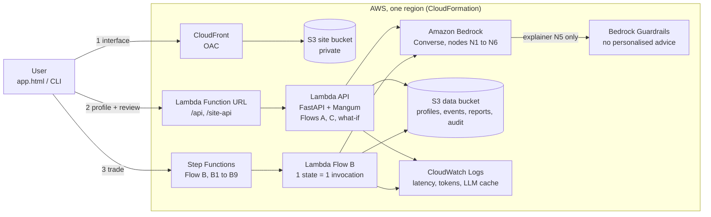
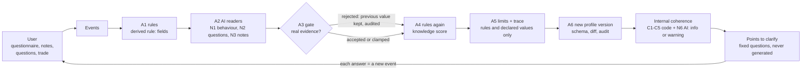
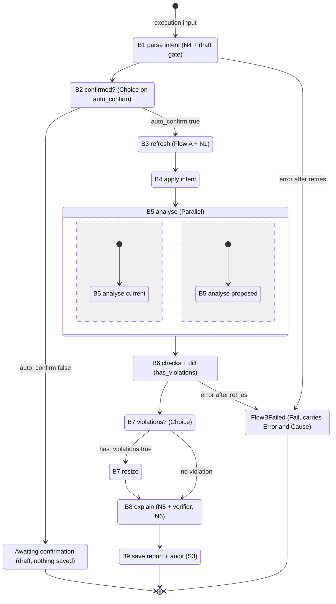

# Compass (CoherenceAnalyzer)

Compass is an AI loop that refines an investor's profile with every move, while a safety gate keeps only what it can prove. Rules, not the AI, check the portfolio against it. Datathon 2026 / PolyFinances AlphaForge AI.

- **Live app:** https://d36xzk6fhvfvuw.cloudfront.net/app.html
- **One-pager:** [docs/deliverables/one-pager.pdf](docs/deliverables/one-pager.pdf)
- **AWS architecture:** [docs/deliverables/architecture-aws.pdf](docs/deliverables/architecture-aws.pdf)
- **Interactive run flowchart:** [docs/index.html](docs/index.html) (open in a browser)
- **Spec (source of truth):** [SPEC.md](SPEC.md) · approved resolutions: [docs/spec-decisions.md](docs/spec-decisions.md)

The package is named `coherence_analyzer` (the project's working name); Compass is the product name.

## How it works

Every move the investor makes (a questionnaire answer, a free-text note, a question, a proposed trade) becomes an
event. Bedrock LLM nodes propose what it says about the investor; a deterministic **gate** keeps only what it can
prove (real `event_id`s or exact quotes of the user's notes). **Limits come from rules and declared values only, never
from the AI**, and LLM-derived checks can only warn. The portfolio, or the proposed trade, is then checked against
those limits, and anything still unclear goes back to the user as a fixed question.

Robert (59, low-to-moderate risk, 4-year horizon) asks for 10 % NVDA funded from the bond fund ZST: the verdict is
**incoherent**, with 6 of the limits from Robert's own profile crossed, before/after metrics and a plain-language
explanation whose every number is machine-checked. No buy/sell advice, no execution.

## Architecture

Serverless on AWS, defined in CloudFormation. Details: [docs/aws-deploy.md](docs/aws-deploy.md) and the
[architecture PDF](docs/deliverables/architecture-aws.pdf).



The profile-refinement loop (Flow A), rerun on every event:



The trade check (Flow B) as a Step Functions state machine (`deploy/aws/flow_b.asl.json`):



## Quick start

Python 3.11. Everything runs offline: `COHERENCE_ANALYZER_LLM=mock` replays recorded Bedrock responses from
`fixtures/llm_cache/`, so no AWS account is needed.

```
git clone https://github.com/DriftCastSam/Datathon2026-CoherenceAnalyzer.git && cd Datathon2026-CoherenceAnalyzer
python3.11 -m venv .venv && . .venv/bin/activate
pip install -r requirements.txt
COHERENCE_ANALYZER_LLM=mock pytest -q -n auto --dist loadfile                                            # full suite, ~1 min
COHERENCE_ANALYZER_STORE_DIR=.cache/store COHERENCE_ANALYZER_LLM=mock python -m coherence_analyzer.cli demo   # Robert + NVDA, end to end
COHERENCE_ANALYZER_LLM=mock python deploy/serve_local.py                                                   # the app at http://127.0.0.1:8000
```

Live Bedrock calls (`COHERENCE_ANALYZER_LLM=record`) need AWS credentials and `BEDROCK_MODEL_ID` in `.env`
(see `.env.example`). Deploying to AWS: see [AWS deploy](#aws-deploy).

## Layout

```
coherence_analyzer/   package: engine, rules/, coherence/, llm/, gate, intent, resizer, explain, pipeline, store, api, cli
data/                 starter/ (organisers' pack, unmodified), meta/ (hand-built, sourced: see data/meta/SOURCES.md)
fixtures/             personas (robert, amira, mateo) + llm_cache/ for mock mode
deploy/               site/ (dashboard), aws/ (CloudFormation stack, Flow B state machine, deploy.sh)
docs/                 index.html (interactive run flowchart), deliverables/, assumptions, AWS deploy, spec decisions
tests/                pytest, all offline
```

## Data

- **Prices:** listing currency (`.TO` is CAD, everything else USD). Converted to CAD with month-end USDCAD, forward-filled.
- **Calendars:** no calendar alignment. Monthly resampling (`ME`, last) absorbs TSX/US/crypto calendar differences.
- **Window:** monthly returns 2022-01 → 2026-10 (58 months). `iloc[2:-1]` also drops Dec 2021; this is kept for golden parity (SPEC §3.1). The window includes 2022, when stocks and bonds fell together.
- **Survivorship bias:** the universe was selected in 2026.

## Known limitations

SPEC §19. These describe what the tool does and does not cover.

- **Short history, resampled; expected return ASSUMED.** The simulation uses a 5-year window of month-end data. The block bootstrap resamples that same history, so it cannot produce regimes the window did not contain. The drift (expected return) is a team assumption, labelled ASSUMED in the report; it is not a forecast. The cone is a description of the simulated paths under those inputs.
- **Survivorship bias.** The asset universe was chosen after the fact, from funds and stocks that exist today. Series of assets that closed or were delisted are absent, so historical returns can read better than the full set of outcomes.
- **ETF look-through and unknowns.** Without ETF look-through, the sector, employer and activity checks on an ETF are `unknown`: the tool does not guess what an ETF holds. What look-through covers now (P2.13): when `data/meta/etf_sector_weights.csv` has a covered row set for an equity ETF, the sector weights feed H6 (employer sector) and H10 (sector concentration). H11 (excluded activities) stays `unknown` for ETFs, because sector weights carry no activity evidence; only a sourced row in `data/meta/activity_tags.csv` (entered by a human) can settle it. The file is a human task and is not committed yet, so real runs report `lookthrough: false` and these checks stay `unknown`. Unknowns are listed apart and do not change the verdict.
- **Behaviour classification is noisy.** The N1 label of an event is an LLM reading of free text. Its confidence is capped at 0.8, and a behaviour pattern needs at least 2 events before it is reported. The result is a warning (or info), never a block, and it never feeds `limits`.
- **Team calibrations, not regulation (AMF / CIRO / KYC).** The values in the limits table are team calibrations. The real equivalent, the suitability and know-your-client (KYC) assessment under AMF and CIRO rules, is out of scope. Nothing here is a regulation check or a compliance opinion.

## Further reading

- [docs/assumptions.md](docs/assumptions.md): every team assumption and SPEC-AMBIGUITY resolution
- [docs/aws-deploy.md](docs/aws-deploy.md): CloudFormation, Flow B on Step Functions, live API Lambda
- [SPEC.md](SPEC.md), [docs/spec-decisions.md](docs/spec-decisions.md), [docs/spec-factors.md](docs/spec-factors.md)
- Build history: `git log`

## Disclaimer

Educational simulation with fictional profiles. This is not personalised financial advice. No transaction is executed.
