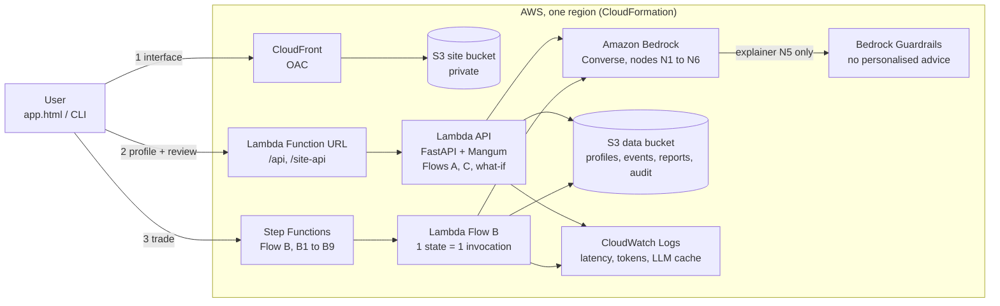
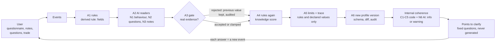
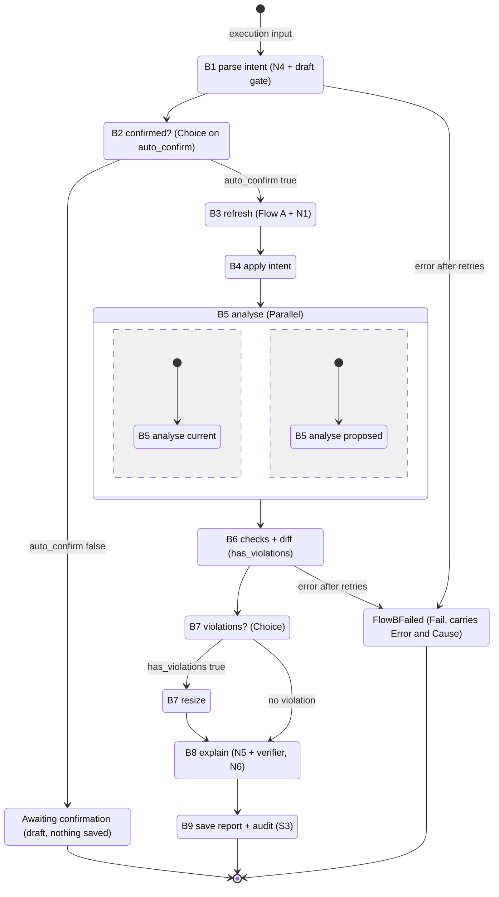

# Compass: AWS deploy

Full deployment reference. Overview and diagrams: [README](../README.md#architecture).

## Architecture



The profile-refinement loop (Flow A), rerun on every event:



## AWS deploy

The template is `deploy/aws/coherence-analyzer.cfn.json` (S3 bucket with versioning, public access block, SSE and a TLS-only policy; Bedrock Guardrail with a denied topic for personalised investment recommendations; one least-privilege managed policy). It is never deployed by the tests or the build. To deploy by hand:

```
aws cloudformation deploy \
  --template-file deploy/aws/coherence-analyzer.cfn.json \
  --stack-name coherence-analyzer \
  --capabilities CAPABILITY_IAM \
  --parameter-overrides ModelArn=<bedrock model or inference profile ARN> S3Prefix=ca/
aws cloudformation describe-stacks --stack-name coherence-analyzer --query "Stacks[0].Outputs"
```

Deployed 2026-11-14 as stack `coherence-analyzer` (us-east-1), guardrail version 2. Version 1 blocked factual
"limit X, holds Y" sentences and the explainer's own rules text on input. Version 2 narrows the denied topic to
recommendations addressed to the reader and evaluates the model output only (`InputEnabled: false`). Probe results
with ApplyGuardrail: every buy/sell/reallocate directive tried (fr + en) is blocked, and every French factual
divergence sentence passes. One English factual sentence ("Crypto is 15.0 % ... above the 10.0 % cap") is still a
false positive, which costs that section its LLM narration (template fallback).

Attach the `AccessPolicyArn` output to the role or user that runs the app, then set in `.env`:

```
COHERENCE_ANALYZER_STORE=s3
COHERENCE_ANALYZER_S3_BUCKET=<BucketName output>
COHERENCE_ANALYZER_S3_PREFIX=ca                  # the S3Prefix parameter without the trailing slash
BEDROCK_MODEL_ID=<model id matching ModelArn>
BEDROCK_GUARDRAIL_ID=<GuardrailId output>
BEDROCK_GUARDRAIL_VERSION=<GuardrailVersion output>
```

### Flow B on Step Functions (P2.15)

The same template also holds Flow B as a Step Functions state machine (`FlowBStateMachine`, definition
`deploy/aws/flow_b.asl.json`, copied inline into the template) and the one Lambda that runs every step
(`FlowBFunction`, handler `coherence_analyzer.lambda_handler.handler`, python3.11). Each Task sends
`{"step": "<pipeline step function>", ...}`; the steps are the pipeline's own functions, so an execution gives the
same report as `python -m coherence_analyzer.cli check ... --auto-confirm`. The Lambda runs with
`COHERENCE_ANALYZER_LLM=live` and `COHERENCE_ANALYZER_STORE=s3` on the stack's bucket and prefix (report and audit go to
`<prefix>/reports/` and `<prefix>/audit/`), the guardrail of the stack, and `BEDROCK_MODEL_ID` from the `BedrockModelId`
parameter. Its role is `AppAccessPolicy` plus its own log group; the state machine role may only call
`lambda:InvokeFunction` on that function. Nothing here is deployed by the tests or the build.

Package the Lambda code (dependencies, the package, the starter data, the meta tables and the fixtures the execution
input names) as a zip, upload it to S3, then update the stack. The Flow B resources (`FlowB*` and the `StateMachineArn`
output) carry the `DeployFlowB` condition: `LambdaCodeS3Bucket` and `LambdaCodeS3Key` default to empty, and while either
is empty a stack update creates no Lambda and no state machine, so updates that do not pass them keep working.
`BedrockModelId` defaults to `us.anthropic.claude-sonnet-5-5`. Pass the code location to deploy Flow B. The template
passes `cfn-lint` 1.60.1 (`uvx cfn-lint --regions us-east-1 -- deploy/aws/coherence-analyzer.cfn.json`, exit 0, no findings);
the nested `States.JsonMerge` in B6 is valid ASL (up to 10 nested intrinsics per field).

`deploy/aws/deploy.sh` mechanizes the build/upload/deploy/report commands below as flags; the manual listing stays the reference.

```
rm -rf build && mkdir build
pip install -r requirements.txt --target build --platform manylinux2014_x86_64 --only-binary=:all: --python-version 3.11
cp -r coherence_analyzer build/ && mkdir -p build/data && cp -r data/starter data/meta build/data/ && cp -r fixtures build/
(cd build && zip -qr ../flow-b-lambda.zip . -x '*/__pycache__/*')
aws s3 cp flow-b-lambda.zip s3://<artifact bucket>/coherence-analyzer/flow-b-lambda-<version>.zip
aws cloudformation deploy \
  --template-file deploy/aws/coherence-analyzer.cfn.json \
  --stack-name coherence-analyzer \
  --capabilities CAPABILITY_IAM \
  --parameter-overrides ModelArn=<same as before> S3Prefix=ca/ BedrockModelId=<model id> \
      LambdaCodeS3Bucket=<artifact bucket> LambdaCodeS3Key=coherence-analyzer/flow-b-lambda-<version>.zip
aws cloudformation describe-stacks --stack-name coherence-analyzer \
  --query "Stacks[0].Outputs[?OutputKey=='StateMachineArn'].OutputValue" --output text
aws stepfunctions start-execution --state-machine-arn <StateMachineArn output> \
  --input '{"fixture_dir": "fixtures/robert", "intent_id": "in_0001", "auto_confirm": true}'
```

A new zip needs a new `LambdaCodeS3Key` (CloudFormation does not see a changed object under the same key; or use
`aws lambda update-function-code` for a quick test). After editing `flow_b.asl.json`, copy it into
`FlowBStateMachine.Properties.Definition` (`tests/aws/test_stepfunctions_sync.py` fails until both are equal). The
`fixture_dir` of the execution input is a path inside the zip (relative to `/var/task`), like the CLI's
`fixtures/<persona>`. The live LLM cache goes to `/tmp/llm-cache` (`COHERENCE_ANALYZER_RUNTIME_CACHE_DIR`), the package
directory being read-only.

Execution input `{fixture_dir, intent_id, auto_confirm}`; output: `{"report": <Flow B report>}`, or, when `auto_confirm`
is false, the draft (`status: awaiting_confirmation`, `draft`, `draft_gate`, `intent`, `event`) and nothing saved.
There is no task-token callback: confirming means starting a new execution with `auto_confirm: true`. Every Task
retries the four Lambda service errors (3 attempts, backoff 2) and catches every other error into the `FlowBFailed`
Fail state, which carries the Lambda error type and message.



Every Task (B1, B3 to B9, both B5 branches) and the Parallel state lead to `FlowBFailed` on error; the diagram shows two.

The Flow B steps, including the Parallel engine state, are in the flowchart at [docs/index.html](docs/index.html); the state machine itself is `deploy/aws/flow_b.asl.json`.

### Live API Lambda (Function URL)

The same template also holds a second Lambda, `ApiFunction` (handler `coherence_analyzer.api_lambda_handler.handler`,
python3.11), that serves the whole FastAPI app (`coherence_analyzer.api.app`: profiles, reviews, corrections, intake,
mounted at `/api`) plus the `/site-api/*` display-layer routes app.html's live mode actually calls (`deploy/site_api.py`:
review/whatif wrapped with the `site` block: profile card, limits, "points to clarify"), over one Lambda Function
URL (`ApiFunctionUrl`), so the CloudFront-hosted static site (`deploy/site/`) can call it directly instead of going
through `deploy/serve_local.py`'s uvicorn process. This mirrors `deploy/serve_local.py`'s own one-origin layout
(`/api/*` + `/site-api/*`) exactly, minus the static file mount, which CloudFront owns instead. Mangum
(`mangum` in `requirements.txt`) adapts the Function-URL event into one ASGI request/response cycle against the
combined app; see `coherence_analyzer/api_lambda_handler.py` for the adapter, the mounting, and why `lifespan="off"`.
It runs with `COHERENCE_ANALYZER_LLM=live` and `COHERENCE_ANALYZER_STORE=s3` on the stack's bucket and prefix, the
guardrail of the stack, and `BEDROCK_MODEL_ID` from the `BedrockModelId` parameter, the same environment variables as
`FlowBFunction` (`COHERENCE_ANALYZER_LLM`, `COHERENCE_ANALYZER_STORE`, `COHERENCE_ANALYZER_S3_BUCKET`,
`COHERENCE_ANALYZER_S3_PREFIX`, `BEDROCK_MODEL_ID`, `BEDROCK_GUARDRAIL_ID`, `BEDROCK_GUARDRAIL_VERSION`,
`COHERENCE_ANALYZER_RUNTIME_CACHE_DIR=/tmp/llm-cache`). Its Function URL has `AuthType: NONE` plus the two
`lambda:InvokeFunctionUrl`/`lambda:InvokeFunction` permissions a public Function URL needs, and CORS mirroring
`api.py`'s own `CORSMiddleware` (`GET`, `POST`, `PUT`, all origins and headers). Nothing here is deployed by the
tests or the build.

`ApiFunction` and `ApiFunctionUrl` carry the same `DeployFlowB` condition as the Flow B resources, and reuse
`FlowBFunction`'s exact `Code` block (`LambdaCodeS3Bucket`/`LambdaCodeS3Key`), one zip artifact serves both
Lambdas. If you already built and uploaded `flow-b-lambda.zip` for Flow B, there is no separate packaging step:
a stack update that passes the same `LambdaCodeS3Bucket`/`LambdaCodeS3Key` picks up `ApiFunction` automatically.
Packaging from scratch is the same commands as Flow B (also mechanized by `deploy/aws/deploy.sh`), plus the extra
`deploy/` trio alongside `coherence_analyzer/`, needed for the `/site-api/*` routes' `site_extras`/`whatif` calls:

```
rm -rf build && mkdir build
pip install -r requirements.txt --target build --platform manylinux2014_x86_64 --only-binary=:all: --python-version 3.11
cp -r coherence_analyzer build/ && mkdir -p build/data build/deploy
cp -r data/starter data/meta build/data/ && cp -r fixtures build/
cp deploy/site_api.py deploy/build_site.py deploy/whatif.py deploy/basket_chat.py deploy/search_ask.py build/deploy/
(cd build && zip -qr ../flow-b-lambda.zip . -x '*/__pycache__/*')
aws s3 cp flow-b-lambda.zip s3://<artifact bucket>/coherence-analyzer/flow-b-lambda-<version>.zip
aws cloudformation deploy \
  --template-file deploy/aws/coherence-analyzer.cfn.json \
  --stack-name coherence-analyzer \
  --capabilities CAPABILITY_IAM \
  --parameter-overrides ModelArn=<same as before> S3Prefix=ca/ BedrockModelId=<model id> \
      LambdaCodeS3Bucket=<artifact bucket> LambdaCodeS3Key=coherence-analyzer/flow-b-lambda-<version>.zip
aws cloudformation describe-stacks --stack-name coherence-analyzer \
  --query "Stacks[0].Outputs[?OutputKey=='ApiFunctionUrl'].OutputValue" --output text
```

Smoke-test once deployed:

```
curl <ApiFunctionUrl output>/api/health
```

should return the same `{"ok": true}` body as the app's local `/api/health` route (note the `/api` prefix: the
Function URL mirrors `serve_local.py`'s layout, not a bare `api.app`). To wire the CloudFront-hosted static site to
it, build with `python deploy/build_site.py --api-base <ApiFunctionUrl output> <out dir>`: this writes the Function
URL into the *built* `app.html`'s `<meta name="coherence-api-base">` (never the source file under `deploy/site/`,
which always ships with that tag empty, see `deploy/build_site.py`'s `_set_api_base`), then sync `<out dir>` to the
site bucket and invalidate CloudFront. See `apiBase()` in `deploy/site/js/core/data_source.js` for where every API
call reads the base from (`window.COHERENCE_API_BASE` first, then the meta tag).
